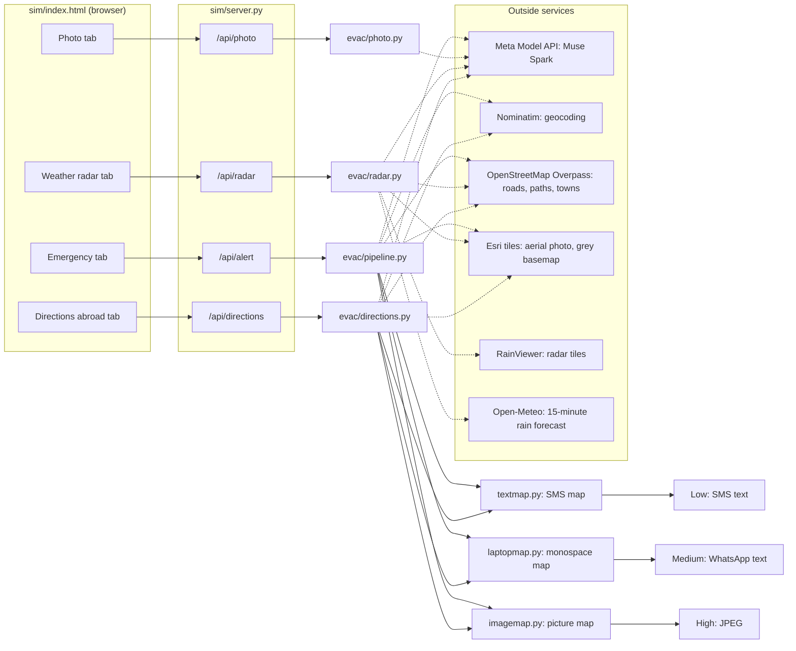
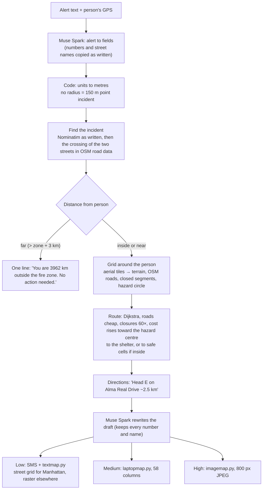
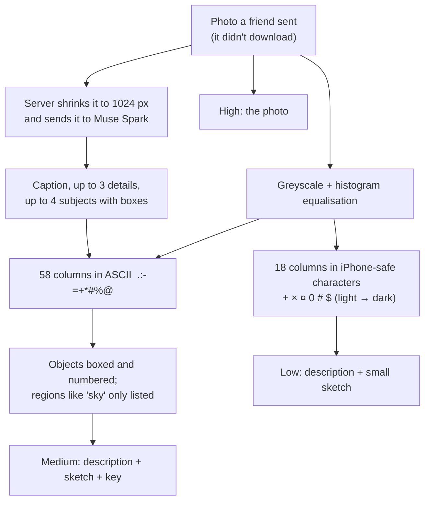
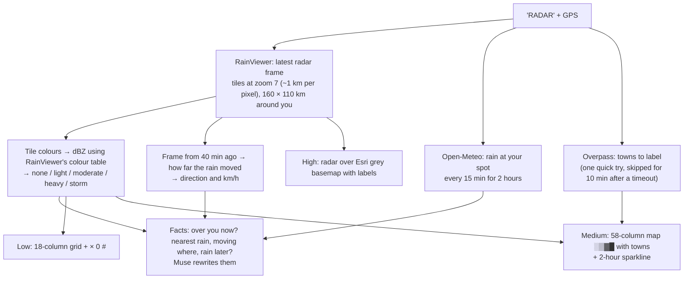
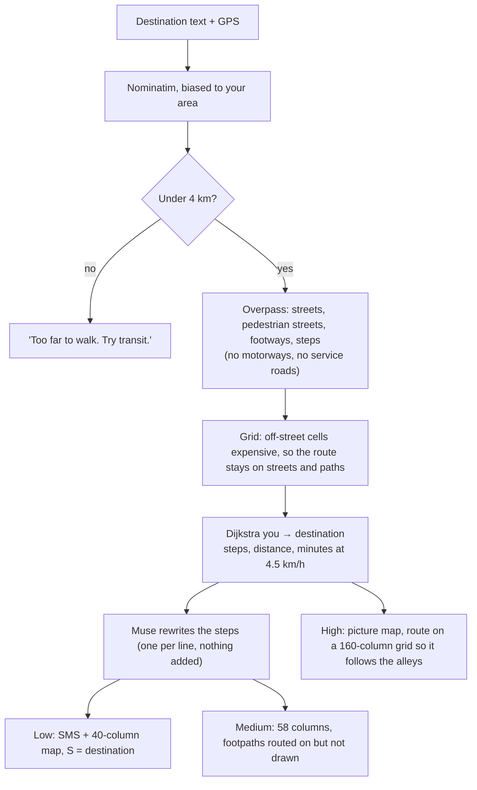
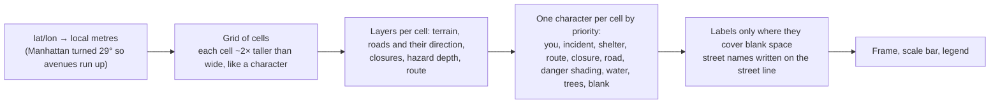

# MapsImagesText

Pictures for people who can only receive text. A server with a good connection does the heavy work (reading an alert, looking at a photo, reading the weather radar, routing on street data) and sends the result back as text that still works as a picture: a map or sketch drawn in characters. It comes in three sizes, one for each kind of connection:

| | Channel | What arrives | Typical size |
| --- | --- | --- | --- |
| **Low data** | SMS on an iPhone | instructions + a small text map in characters that line up in iPhone Messages | 6 to 12 SMS parts (~1 to 1.7 KB) |
| **Medium data** | WhatsApp (or any app that shows monospace text) | instructions + a 58-column monospace map | 2 to 5 KB of text, 0.3 to 1 KB compressed |
| **High data** | anything that loads images | an ordinary picture map or the photo itself | 55 to 180 KB |

It has four modes, one per tab in the simulator:

- **Emergency:** an alert text (fire, gas leak, wildfire, flood) plus the person's GPS gives "are you affected, what to avoid, which way out".
- **Photo:** a photo that won't download comes back as a description plus the photo drawn in text.
- **Weather radar:** "is rain coming?" comes back as the latest radar around you plus a 2-hour forecast for your spot.
- **Directions abroad:** walking directions on a capped roaming plan, routed on real street data from your GPS.

Built on the Meta Model API (Muse Spark; SAM 3.1 planned).

## How it fits together



Every mode returns the same three versions, and the page shows them side by side with their real sizes. Everything slow or flaky is cached (`cache/osm/` for road data) or has a fallback: no model key means regex parsing and template text; no road data means routing on imagery only; no town names means the radar map is drawn without them.

### What Muse Spark does, and doesn't

| Muse does | Code does |
| --- | --- |
| Reads the alert into fields: hazard, order, place, radius **as written**, shelters, closed road segments | Converts units, geocodes, finds intersections in road data, decides "affected or not" |
| Looks at a photo: caption, details, boxes around the main subjects | Draws the photo in characters, boxes the subjects, sizes everything |
| Rewrites the drafts (instructions, directions, weather facts) into calm short text, told to keep every number and name | Routing, distances, directions, every map, every legend |

Muse never sees or edits a map, so it can't break one. It runs with `reasoning_effort: minimal` (1 to 2.5 s per call).

## Emergency mode



Samples are in [`samples/`](samples/); the NYC alerts are fictional drills.

### NYC fire, you are 3 blocks east

Input: [`samples/nyc_fire.txt`](samples/nyc_fire.txt), location `40.75491,-73.97441`.

```bash
python3 main.py samples/nyc_fire.txt --at 40.75491,-73.97441 --laptop 58
```

Low data (SMS, 12 parts):

```
FDNY on scene at 5 Av and W 47 St.
Fire incident 400 m from you.
Avoid 5 Av between W 42 St and W 50 St.
Expect road closures and smoke.

MAP (uptown is up):
=================== 51 St
  |     |     |     |     |  
=====×============= 50 St
  |    ×    |     |     |  
=====×============= 49 St
  |   +×++  |     |     |  
=====×============= 48 St
  |   +×+++ |     |     |  
=====#========= 🔴 == 47 St
  |   +×+++ |     |     |  
=====×============= 46 St
  |   +×++  |     |     |  
=====×============= 45 St
  |    ×    |     |     |  
=====×============= 44 St
  |    ×    |     |     |  
=====×============= 43 St

# fire: AVOID
+ near the fire: expect smoke and crews
× road closed: AVOID
= open road
🔴 you
Avenues left to right: 6 Av, 5 Av, Madison, Park, Lex
```

Medium data (WhatsApp, 3.7 KB, 0.6 KB compressed):

```
FDNY on scene at 5 Av and W 47 St.
Fire incident 400 m from you.
Avoid 5 Av between W 42 St and W 50 St.
Expect road closures and smoke.

             Vanderbilt Av  Lexington Av
 5th Av  Madison Av  Park Av            3rd Av        2nd Av
┌─ ↑ uptown ───────────────────────────────────────────────┐
│───╋─────────╋────────╋╋─────────╋────────╋── 52nd St ──╋─│
│   ┃         ┃        ┃┃         ┃        ┃             ┃ │
│   ┃         ┃        ┃┃         ┃        ┃             ┃ │
│───╋─────────╋────────╋╋─────────╋────────╋── 51st St ──╋─│
│   ┃         ┃        ┃┃         ┃        ┃             ┃ │
│━━━×━━━━━━━━━╋━━━━━━━━╋╋━━━━━━━━━╋━━━━━━━━╋━━ 50th St ━━╋━│
│   ×         ┃        ┃┃         ┃        ┃             ┃ │
│   ×         ┃        ┃┃         ┃        ┃             ┃ │
│━━━×━━━━━━━━━╋━━━━━━━━╋╋━━━━━━━━━╋━━━━━━━━╋━━ 49th St ━━╋━│
│░░░×░░░░░    ┃        ┃┃         ┃        ┃             ┃ │
│───×─────────┃────────╋╋─────────╋──────  ┃             ┃ │
│▒▒▒×▒▒▒▒▒░░░ ╋        ┃┃         ┃      ──╋── 48th St ──╋─│
│▒▓▓×▓▓▒▒▒▒░░░┃        ┃┃    YOU  ┃        ┃             ┃ │
│───◆─────────╋────┼───╋╋────🔴───╋────────╋── 47th St ──╋─│
│▒▓▓×▓▓▒▒▒▒░░░┃    │   ┃┃         ┃        ┃             ┃ │
│▒▒▒×━━━━━━━━━╋━━━━╋━━━┃┃         ┃        ┃             ┃ │
│━━━×▒▒░░░░░  ┃    │  ━╋╋╋━━━━━━━━╋━━━━━━━━╋━━ 46th St ━━╋━│
│░░░×░░░░░    ┃    │   ┃ ┃        ┃        ┃             ┃ │
│━━━╋━━━━━━━━━╋━━━━╋╋━━━━━╲╋━━━━━━╋━━━━━━━━╋━━ 45th St ━━╋━│
│   ×         ┃    │┃      ┃      ┃        ┃             ┃ │
│   ×         ┃    │┃      ┃      ┃        ┃             ┃ │
│───×─────────╋────┼┃      ┃      ╋────────╋── 44th St ──╋─│
│   ×         ┃    │┃      ┃      ┃        ┃             ┃ │
│───×─────────╋────╱┃      ┃      ┃        ┃── 43rd St ──╋─│
│   ×         ┃     ┃      ┃      ┃        ┃             ┃ │
│   ×         ┃     ┃╲━━╋━━╋      ┃        ┃             ┃ │
│━━━╋━━━━━━━━━╋━━━━━━━━━╋━━━━━━━━━╋━━━━━━━━╋━━ 42nd St ━━╋━│
└─ ├───────────┤ 200 m ────────────────────────────────────┘

🔴 you
◆ incident   ░▒▓ danger zone, darker is closer
× road closed
━ main road   ─ street
Avenues run up and down, streets left and right.
```

High data (95 KB JPEG):


### NYC gas leak, a street closure

Input: [`samples/nyc_gas_leak.txt`](samples/nyc_gas_leak.txt), location `40.7560,-73.9740`.

```
Gas leak 220 m from you at Lexington Av and E 51 St.
Con Edison and FDNY are responding.
Avoid E 51 St (Park Av to 3 Av).
Expect delays in Manhattan.

MAP (uptown is up):
=============== 53 St
  |     |  ++ | ++  |  
=============== 52 St
  |     | +++ | +++ |  
=====××××#××××= 51 St
  |     | +++ | +++ |  
=============== 50 St
  |     |  ++ | ++  |  
=============== 49 St
  |     |   🔴  |     |  
=============== 48 St
  |     |     |     |  
=============== 47 St

# gas: AVOID
+ near the leak: stay clear
× road closed: AVOID
= open road
🔴 you
Avenues left to right: Madison, Park, Lex, 3 Av
```

### Wildfire, you are inside the zone

Input: [`samples/palisades_fire.txt`](samples/palisades_fire.txt), location `34.0445,-118.5300`.

Low data (SMS):

```
EVACUATE NOW.
You are INSIDE wildfire zone near Temescal Canyon Park.
Mandatory evacuation within 2 miles.
Go to Westwood Recreation Center.
Head E on unnamed road ~210 m.
Head E on Alma Real Drive ~2.5 km.
Head E on 17th Street ~620 m.
Continue to Westwood Recreation Center (7.6 km E).
Avoid Sunset Blvd, Palisades Dr.

MAP (north is up):
 ×××      === 
 ××+++++++ ××=
 +××####+××××× Sunset Blvd
~++### 🔴 >>>+==
~++######+++== PCH
~~+++++++++===
~~~~++++~  ===

# wildfire: AVOID
+ evacuation zone: leave
× road closed: AVOID
= open road
~ water
< > Λ v way out
🔴 you
```

Medium data (4.5 KB, 0.9 KB compressed; at this scale one character is 142 m, so side streets are left out):

```
EVACUATE NOW.
You are INSIDE wildfire zone near Temescal Canyon Park.
Mandatory evacuation within 2 miles.
Go to Westwood Recreation Center.
Head E on unnamed road ~210 m.
Head E on Alma Real Drive ~2.5 km.
Head E on 17th Street ~620 m.
Continue to Westwood Recreation Center (7.6 km E).
Avoid Sunset Blvd, Palisades Dr.

┌─ ↑ N ────────────────────────────────────────────────────┐
│      ××××  ··    ··  ····················     ╲╲  ·      │
│··   ·× ××××××     ·· ········  ·· · ···· ·     ╲─╲  ╲    │
│···  ·××      ××   ···         ·    ···   ·       ╲╳ ╲╲│  │
│  ·····×××  ·    ··· ··   ····  ·  ·     ···  ·   ││   ╲╲ │
│    ·····××··   · ··░░░░░░░░░░░░░░·   ·· ·····     ╲╲·  ╲╲│
│ · ·······×····░░░░░░░░░░░░░░░░░░░░░░░·    ··       │     │
│····  ·· ·××·Palisades Dr░░░░░░Mandeville Canyon Rd │·    │
│··  ····  ░░×░░░░░░░░░░░░░░░░░░░░░░░░░░░░░░·       ××     │
│·········░░░××░░░░░░▒▒▒▒▒▒▒▒▒▒▒▒▒▒░░░░Sunset Blvd ××××××××│
│  ·····░░░░░░×░░░▒▒▒▒▒▒▒▒▒▒▒▒▒▒▒▒▒▒▒▒░░░░░░░░░  ×××─╲     │
│······░░░░░░░××▒▒▒▒▒▒▒▒▒▒▒▒▒▒▒▒▒│▒▒▒▒▒▒░░×░░░××××  ││     │
│·     ░░░░░░░░×▒▒▒▒▒×××××××××××▒│▒▒▒▒▒▒▒×××░×░░░·· ╲╲━━━━⌂│
│     ░░░░░░░░▒×▒▒▒▒▒×▒▓▓▓▓▓▓╱┃×××▒▒▒▒▒▒×××××░░░░░·╱╱╱╳╲╲  │
│     ░░░░░░░▒×××▒▒▒××▓▓▓▓▓▓▓┃🔴▓×××▒▒××▒▒░░░░░░░╱╱╱    ╲╲╲│
│╱╱━━━━━╲░░░░▒××××××▓▓▓▓▓▓▓▓┃▓││↘▓╳▒×××▒▒▒▒░░░░╱╳╳        ╲│
│≈≈≈≈░░░░━━╲━╋╋━━━━━━━━╲▓▓▓◆╱▓│▓▓↘→→→→▒▒▒▒▒░░╱╳╳░╲╲╲     ┼╱│
│≈≈≈≈░░░░░░░░▒▒▒▒▒▒▒▒▓▓╲╲╲╳╱▓▓│▓▓▓╳▒││↘→→→→→→→→→→→→→╲╲ ╱┼┼ │
│≈≈≈≈≈░░░░░░░▒▒▒▒▒▒▒▒▒▓▓▓▓╲╲╲╲▓▓▓│╱▒│▒▒▒▒▒╱┼┃┃░░░░╲╲ ╱╳╲ ╲╲│
│≈≈≈≈≈░░░░░░░░▒▒▒▒▒▒▒▒▒▒▓▓▓▓▓▓╲━╲┃╲▒│╲▒─╱╱╱╳╳░░░░  ╱╳╳ ╲╲╲ │
│≈≈≈≈≈≈░░░░░░░░▒▒▒▒▒▒▒▒▒▒▒▒▒▒▒▒▒▒▒╲╲╋╳╱─░╱╳╳░░░░░╱╳╲╲╲╲╲ ╳╋│
│≈≈≈≈≈≈≈░░░░░░░░░▒▒▒▒▒▒▒▒▒▒▒▒▒▒▒▒▒▒▒▒╲╲╋╋╳░╲╲╲░╱╳╲╲ ╲╲╲╳╳╳ │
│≈≈≈≈≈≈≈≈░░░░░░░░░░▒▒▒▒▒▒▒▒▒▒▒▒▒▒▒▒▒░░░░╲╲╲╲░╱┼╲  ╲╲╲╱╳╳╲╳╳│
│≈≈≈≈≈≈≈≈≈≈░░░░░░░░░░░░░▒▒▒▒▒▒▒▒░░░░░░░░░░░╲╳╳  ╲╲ ╱╳╳╲╱╳╳╱│
│≈≈≈≈≈≈≈≈≈≈≈░░░░░░░░░░░░░░░░░░░░░░░░░░░░░PCH ╲╲╋ ╳╳╳╳╱╳╳╳╱╳│
│≈≈≈≈≈≈≈≈≈≈≈≈≈≈░░░░░░░░░░░░░░░░░░░░░░░░░░····  ╲╳╳╳╳╳╳╳╱╳╳╳│
│≈≈≈≈≈≈≈≈≈≈≈≈≈≈≈≈≈░░░░░░░░░░░░░░░░░░░···Ocean Av ╲╳╳╳╳╋╋╳╱╳│
│≈≈≈≈≈≈≈≈≈≈≈≈≈≈≈≈≈≈≈≈≈≈≈≈≈░░░░Santa Monica Freeway ╲╋╳╳╳╳╳╱│
└─ ├────────────┤ 2 km ────────────────────────────────────┘

🔴 you
◆ incident   ░▒▓ danger zone, darker is closer
× road closed
→ way out
⌂ shelter
━ main road   ─ street
≈ water
· trees / park
```

## Photo mode



Example: "Eagle & Waterfall", one of the photos macOS ships in `/Library/Desktop Pictures` (the simulator offers them as samples; they are not in this repo).

```bash
python3 main.py --photo eagle.jpg
```

Low data (SMS, 6 parts):

```
Photo: A lone bird soars in silhouette before a massive waterfall shrouded in golden mist and sunlight.
- No readable text is visible
- Warm golden light illuminates the waterfall mist
- A dark cliff face is visible on the right edge

0¤×¤××××++++++   +
000¤¤¤××××+++++ +¤
#0#000¤¤¤××+++++×0
###$###000¤××××פ#
$##$$#####00000¤0$
(the photo, drawn in text)
```

Medium data (1.1 KB of text, 0.37 KB compressed, against a 182 KB photo):

```
Photo: A lone bird soars in silhouette before a massive waterfall shrouded in golden mist and sunlight.
- No readable text is visible
- Warm golden light illuminates the waterfall mist
- A dark cliff face is visible on the right edge

┌1─────────────────┐-::::::::...........              ....
│**+=+=--====------│--::::::::::..........                
│+**++++==+======--│----:-::::::::....... -. .          .-
│=**+++*+=++=======│---------:::::::.....-#: ..        :*#
│+=+*+*#*+++=======│=---------:::::::....:..........  .+**
│#*+**##%*+==+==++=│==----------::::::::............. -+**
│#****##%%*+++++++=│===----=----::::::::::...........:=+**
│##***##%%#+*****++│=+========---:::::::::::........:=++*#
│%%#*#%#%%%****#**+│+++========----::--:-:::::::::..-++*##
│%%%####%%%##******│**++++=++++==------:-::::::.::::=++*##
│%%%%%###%%%%%##**#│****+*++***++=-----------:::::::-+***#
│%##%%%#%#%@@%%%%##│####**#*****+++=====--==--------=+**#@
│%#%%%%%%%%@@@%%%##│##%%#*#####****++++++++=++===--=+*#%@@
│%%#%%#%@@%%@@@%%%#│%%%%%##%%###*********+++++++====+*#%@@
│@@%%%%%%@%@@@@%@%%│%%%@%#%%%%%########****++*++++++**#@@@
└──────────────────┘@%@@@%%%%%%%########*******+++***#%@@@

1  waterfall (middle left)
```

The bird is the small dark mark on the right; Muse mentions it in the caption but boxed only the waterfall.

## Weather radar mode



Example: "Find heavy rain right now" picked `-9.6838, -40.4297` (Bahia, Brazil) on 2026-10-28 00:25 UTC. Radar is live, so this will differ every run.

Low data (SMS, 6 parts):

```
Hi! 21:20 update: no rain over you now. Nearest rain 28 km SW (moderate), moving toward the W at about 35 km/h. Good news: no rain in the next 2 hours for your spot!

RADAR (north is up, 160 km across):
#00×         +××××
 ×00              
0×00×        ×+   
00#000×  🔴     ++++
+0×0+0+       00 ×
++      ×+××××××××

+ light  × moderate
0 heavy  # storm
🔴 you
```

Medium data (2.2 KB of text, 0.4 KB compressed, against a 57 KB radar picture):

```
┌─ ↑ N  radar 21:20 ───────────────────────────────────────┐
│▓██▓▓░░░   ▒                                ░▒░░▒▒░░░     │
│▒▓▓▓▓▓▓ ▒▒▒▒                                              │
│ ░▒▒▒▓▓▓▓                                            ▒▒▒ ▒│
│    ░▒▓▓▓                                                 │
│    ░▒▒░░                                                 │
│    ░░▓▓░▒▓                                               │
│    ░▒▓▓░▒▓▒░░░                                           │
│▓▒  ▒▒▒▒▓▓▒▒▒▒▒▒                          ░░              │
│▓░ ▒▒▒▒▒▓▓▒▒▒▒░░                           ▒▒░░░          │
│   ▒▒▒▓▓▓▓▓▓▓▓▓▓▓           🔴                ░░░░░░      │
│░▓▓▓▒▒▓███▓▓▓▓▓▓▓                                 ░░░░░░  │
│▒▓▓▓▓▓▓▓▓▓▓▓▒▒▒▓▓▒▓░▒                                 ░░░░│
│░░░▒▓▓▓▒░▒▓▓▓    ▓▓▒░                         ▒▓▒░      ▒░│
│          ▓▓▓░   ░▒                           ▒▓▓░░▒      │
│           ░                                  ▒▒▒░░░      │
│                                       ▒▒         ▒▒      │
│                                   ░░▒▒▒▒░▒░░   ▒▒▒▒   ▒▒░│
│░░  ░░                     ░▒░░░░░▒▒▒▒▒▒▒▒▒▒▒░░▒▒▒▒▒▒▒░  ░│
└─ ├───────┤ 25 km ────────────────────────────────────────┘

Your spot, next 2 h (15 min steps): ········
21:15 now  ...  23:00

░ light  ▒ moderate  ▓ heavy  █ storm   🔴 you
```

High data:


## Directions abroad mode

Asked directly, Muse Spark gives walking directions from memory. They read well, but it can't know where you are standing, some turns are wrong (for Rossio to the castle in Lisbon it sent us through the Arco da Bandeira into Praça da Figueira, which it doesn't lead to), and its sketch isn't to scale. So here the route comes from real street data and Muse only rewords it.



Example: Rossio station to Castelo de São Jorge, Lisbon.

```bash
python3 main.py --walk "Castelo de São Jorge, Lisbon" --at 38.7139,-9.1406
```

Low data (SMS, 7 parts):

```
Hey! Walk to Castelo de São Jorge: about 0.7 km, 9 min.
1. Head E on Largo do Duque do Cadaval ~40 m
2. Head E on Praça Dom Pedro IV ~130 m
3. Head E on Praça da Figueira ~360 m
4. Head NE on unnamed road ~140 m

MAP (north is up):
  ==  =====   
== ===  ==    
 ====== ===== 
    == 🔴 >>>S==
====== =======
==============
===========   

= open road
< > Λ v route
🔴 you
S destination: Castelo de São Jorge
```

Medium data (4.6 KB, 1.0 KB compressed). Lisbon's old centre is a dense tangle at 27 m per character:

```
┌─ ↑ N ────────────────────────────────────────────────────┐
│╱╳╲╲╱╳╱╱  ╲╳╲╲╲ ╲╳╲╳╱╲╳╲ │╱  │ │││╲╳╳╳╳╱  │╋─┼──╳╱   ││   │
│ ╱╱╳╲     │╲╲╳╋╳╱ ╲╲╳╱╱╳┼┼╲──┼┼┼╲││╲╳╳┼    ┃╱│ ╱╱╲╳ ╱╱ │┼┼│
│┼─────────╱┼╲│╲╲╲╲ ╲╳╳╱╱╱│  ╱╱╲╲╲╳─╲╳╱─┼─┼─╋┼││─┼┼╱╱  ╱┼ ┼│
│            ╲│╲╳╲╲╲ ╲╳╱╱╱   │╳╱╳    ╲╲╲┼┼╱┃┃│││ ┼│ │╱╱─┼─┼│
│               │╲╲╲╲╳╱╳╲     ││││     ╲╳┼╳┃┃│ │ ╱╲╲│╳╲ ─┼┼│
│              ╱┼┼╳╳╳╳╲ ╲╲╲    ┼╳╳      ╳╳ ┃ │  ┼─╲ ╲──╲┼──│
│╋       ╳───╱╳╳╲╱╳╱╳╲╲╲╱─┼─── ─╲╳╳     │╳ ┃ │╳┼─╲╳╳╱ ╲╳╱  │
│╱━╋╱┃╲ ╳ ╲╲╳╲╲╳╳╳╳╲╱╳╳╳╲╲ ╲╲  ─╲╳╲──    ╳╳╋ │││┼─┼╲╲      │
│─┼╳╱│╲╲╋╲╲╳──╲┼╲╲╲╲╳╲╲╲╲╲╳╱╳╳╲  ──│╲╲╱┼─┃╱╲╋┼╳┼╲ ┼╱│     ││
││┼╱│╲  ╱╋╋╋╋   ╲╲╲╲╲╲╳╳╲╲╲╲╱─╳╳ ╲┼┼┼┼╱│┃┃ ┃│┼┼┼─╳┼┼╲│  │╱╱│
│┼─│╲╳╳╱─┼┼┼│━╋━━━╲╲╲╳│  ╲╲╲╳╱╳╳╲╲╲╲┼╳╱┃┃ ┃┃│ ╱╳╳╳╳╲╲┼╳ ┼│││
│╲╳│╱│──╱─┼┼┼┼┼─╳╳╳╲│╳╲    ╲╳╲│┼─┼┼┼┼╲╋╳╲━┃│╱╱╱────────╲││╲│
│╱╱╳╳╱╱╳──┼││┼┼┼┼╲╳╋╳│ ╲╲    ╲╋╋╋↗→→→→→→→→→→→→→→→→    ╲╲╲┼╲│
│┼╱╱╱──│  ┼─┼│││┼┼┼┼╋╲  ╱╲  ┼╳🔴→ ╋┼ ┼╋┃ ┃─│╱╱││  ⌂ │  │╳╳┼│
│─╱┼┼──┼──┼┼│─┼┼┼┼─┼─╋━╳╱╲╲╲╲┼┼┼┃╋╋╋╋╋╋╲╋╋ ╳┼┼┼  ╱╳─╱┼│ ╲┼┼│
│┼┼       │╱┼┼─┼┼┼┼┼─┼╋┼╱╳╲╲╲│ │┼┼│┼││┼┼╋┃┃┼┼││    ╳╳┼┼┼┼╳╳│
│┼┼┼      │┼ ││││┼┼┼┼┼╋╋┼  ╳╳╳ ─│╱┼┼┼┼│││╋┃┃│╲││ ╳╳┼┼╲╳╲─╳┼│
│─│╲╲    ─┼│╱┼─┼┼┼┼┼┼┼┼╋ ┼┼╱╳╳╳ │ ┼┼┼┼┼┼┼┃┃╋┼╲│╳╲──┼ ╳╱┼─┼┼│
│─┼─┼─┼─┼┼┼┼──┼┼┼┼─┼┼┼│┃ ┼┼╳ ╲──┼│││┼┼┼┼┼┼╋┃╋─╲┼┼╲ │───╱╱╱││
│╳╳╳╳─┼─┼┼╱──┼┼┼┼┼┼─┼┼┼╋┼┼─┼┼─┼┼┼│┼┼┼││┼┼┼┼╋╋━┼╲╳╲╲╲╲───╱╱ │
│╳──┼┼─┼──┼─│┼┼─┼──┼─│╋┃│││││ ││ ┼┼┼┼┼┼┼│┼┼╋╋╋┼╳╲╲╳───╳───┼│
│───┼┼──┼─╱ ┼┼┼─┼──┼─┼╋ │┼│┼┼──┼ ─│┼┼┼┼┼┼┼┼─╋╋╋┼┼┼───┼┼┼──┼│
│┼───┼──┼╲╲─┼┼╲╲┼─┼┼ │┃ ││││   ┼╱╱┼┼─┼─┼┼─┼─╋╋╋━━╋╋┼──┼─╱╋━│
│││      ──╲┼─│╲╲   ─┼╋ │ │││  ┼│┼┼─┼─┼─┼┼┼┼─     ┃   ╱╱╱╱ │
│─┼──┼──┼──┼│ │╲╳╳╲┼┼┼╋─┼─┼─┼──┼─┼─┼┼──┼┼┼││      ╋╱╱╱╱    │
│ │  │ ┼┼  ┼─┼┼─╲│╳╲│╋╋┼─┼┼╱┼──╱       ││┼┼┼╋━━━━━╋        │
│━╋━╋╋━╋━━━╋━╋╋━╋╋╋╋╳╋╋╋╋━╋┃         ━━━╋╋╋╋  ─┼┼┼┼        │
└─ ├──────┤ 250 m ─────────────────────────────────────────┘

🔴 you
→ route
⌂ destination
━ main road   ─ street
```

High data (119 KB):


## How a text map is drawn

All the maps are drawn from map data, not converted from a photo pixel by pixel:



### Why the phone and WhatsApp versions use different characters

- **iPhone Messages uses SF Pro, a proportional font.** Ordinary ASCII art comes out crooked, so the SMS maps use only characters measured (in a browser canvas, `17px system-ui`) to be exactly one digit wide: `= # + < > 0 $ ¤ £ ¥ ×` and U+2007 FIGURE SPACE for blanks. Narrow ones are padded with thin and hair spaces (`|`, `v`); slightly wide ones (`Λ` +6%, `S` +1.2%) appear at most once or twice per row. The code adds up each row's width error and logs it (`worst row drift`); the examples above are 0.03 to 0.04 cells (under half a pixel). Figure spaces and `×` are outside the GSM-7 alphabet, so these messages are UCS-2: 67 characters per SMS part.
- **WhatsApp shows text in triple backticks in a monospace font, but can't colour it.** So the medium maps can use line drawing (`━ ┃ ╋ ╱ ╲`) and shading (`░▒▓█`), all one cell wide in Menlo, Monaco and Courier. Braille dots, common in ASCII art, are avoided: on a Mac they fall back to another font and come out 14% wider. A WhatsApp bubble is at most 65% of the chat pane, which in the simulated window fits 58 columns without wrapping.
- **"You" is the 🔴 red dot in both,** the only way to get colour. It is wider than one character, so it takes two: exactly two in SF Pro (with padding), and a third of a cell short in Menlo (about 2.5 px on that one row).

Previews of the SMS maps rendered in SF Pro on a Mac (not yet checked on a real iPhone):


## Try it: the simulator

```bash
python3 sim/server.py
```

Open http://127.0.0.1:8765. In the Claude desktop app, `.claude/launch.json` starts it in the browser pane.

- **Emergency:** the left phone is **Emergency Response (555) 010-0911**. Type an alert or pick a sample (NYC fire, NYC gas leak, LA wildfire, Pasadena flood) and choose who gets it: **Bob the Builder**, **Wendy** or **Farmer Pickles**, each with their own GPS (one-click places or typed coordinates). Below, the selected person's reply appears three ways. Move them and press **Text MAP** for a fresh reply. The pipeline log shows what Muse parsed and the alignment check.
- **Photo:** pick a sample photo or upload one.
- **Weather radar:** pick a city, type coordinates, or press **Find heavy rain right now** (the strongest storm on the world radar, so there is always something to see).
- **Directions abroad:** pick a starting station (Lisbon, Paris, Rome, Tokyo) and a destination.
- **Clear** empties every thread, result and the log.

Each card's caption gives the real size: SMS parts, text bytes (and compressed), and the picture's size.

## Run it from the command line

```bash
pip install requests pillow numpy
```

Put your Meta Model API key in `.env` (git-ignored):

```
LLAMA_API_KEY=...
```

Optional settings in `.env`: `LLM_BASE_URL` (default `https://api.meta.ai/v1`), `LLM_MODEL` (default `muse-spark-1.3`), `LLM_REASONING_EFFORT` (default `minimal`). Without a key, alerts are parsed with regexes, photos get no description, and messages use templates.

```bash
python3 main.py samples/palisades_fire.txt --at 34.0445,-118.5300 -v          # alert → SMS reply
python3 main.py samples/nyc_fire.txt --at 40.75491,-73.97441 --laptop 58      # + the WhatsApp map
python3 main.py --photo some.jpg                                              # photo → text versions
python3 main.py --radar 40.7128,-74.0060                                      # weather radar as text
python3 main.py --walk "Castelo de São Jorge, Lisbon" --at 38.7139,-9.1406 -v  # walking directions
```

`-v` prints the parsed alert, the distance check, closures found and the map's alignment check.

## Code

| File | Role |
| --- | --- |
| `CLAUDE.md` | Notes for Claude Code: commands, how the pieces connect, the text-map width rules |
| `main.py` | Command line: alerts, `--photo`, `--radar`, `--walk` |
| `sim/server.py` | Simulator server: serves the page; `/api/alert`, `/api/photo`, `/api/radar`, `/api/directions`, `/api/find_rain`, sample photos |
| `sim/index.html` | The four tabs and the three-way result cards |
| `evac/pipeline.py` | Emergency mode: wires the steps together and composes the message |
| `evac/notice.py` | Alert text to structured fields (Muse Spark, regex fallback); unit conversion happens here, not in the model |
| `evac/photo.py` | Photo mode: Muse description and subject boxes, text sketches |
| `evac/radar.py` | Weather radar mode: RainViewer tiles to rain levels, motion, Open-Meteo forecast, three versions |
| `evac/directions.py` | Directions abroad mode: walking route on street data, three versions |
| `evac/textmap.py` | SMS maps aligned for SF Pro (Manhattan street grid, raster elsewhere) |
| `evac/laptopmap.py` | Monospace maps for WhatsApp/laptops: line-drawn roads, shading, labels, route arrows |
| `evac/imagemap.py` | Picture maps (JPEG) in the style of agency alert maps |
| `evac/llm.py` | Meta Model API client; loads `.env`; `reasoning_effort` minimal |
| `evac/geo.py` | Geocoding, distance, local projection |
| `evac/osm.py` | Overpass queries (roads, walkable paths, towns), cached in `cache/`; street-name matching ("5 Av" = "Fifth Avenue"); intersection finding |
| `evac/imagery.py` | XYZ tile stitching (Esri aerial, Esri grey basemap, RainViewer radar) |
| `evac/segment.py` | Aerial image to terrain masks (SAM 3 path, or a colour heuristic) |
| `evac/grid.py` | Routing grid: roads, closures, hazard, lowest-cost route, turn-by-turn directions |

## Data sources

Roads, paths and towns © OpenStreetMap contributors (via Overpass); geocoding by Nominatim; aerial imagery and grey basemap © Esri; radar © RainViewer; forecast by Open-Meteo. Picture maps carry these credits.

## Known limits

- Not yet checked on a real iPhone or in real WhatsApp (fonts, emoji widths, Bold Text, text size).
- The free Overpass servers are the slow, flaky part: a new area takes 30 s to 2 minutes or times out (seen for a new directions destination and for an intersection lookup). When the intersection lookup fails, the incident falls back to the geocoder, which for the gas leak once landed 1.7 km away on the middle of Lexington Avenue; the cache makes repeat runs reliable.
- Radar town names often time out; the map is then drawn without them. "Find heavy rain" works on a coarse world view, so the spot it picks can sit in a gap between storms.
- Walking maps of dense old centres (Lisbon) are busy at 58 columns.
- Muse's rewrites are not checked against the draft; a prompt asks it to keep every number and name.
- Terrain comes from a colour heuristic; SAM 3.1 on the Meta Model API is not wired in yet (Muse's subject boxes stand in for it in photo mode).
- Replies are long: 6 to 12 SMS parts.
