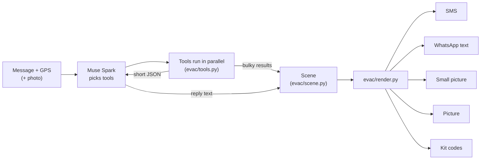
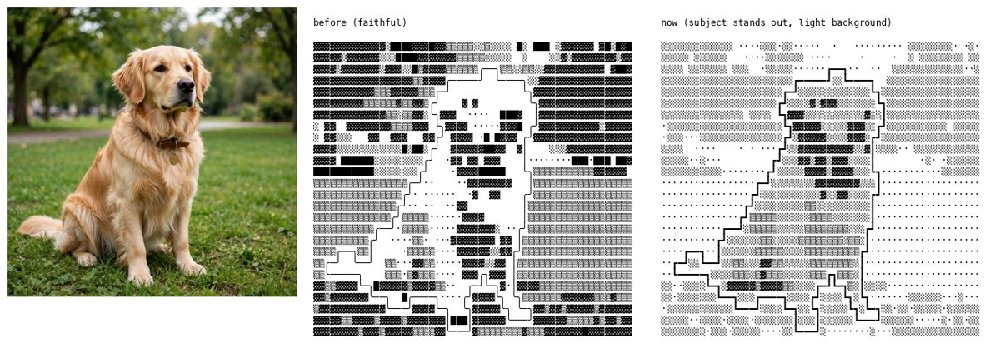
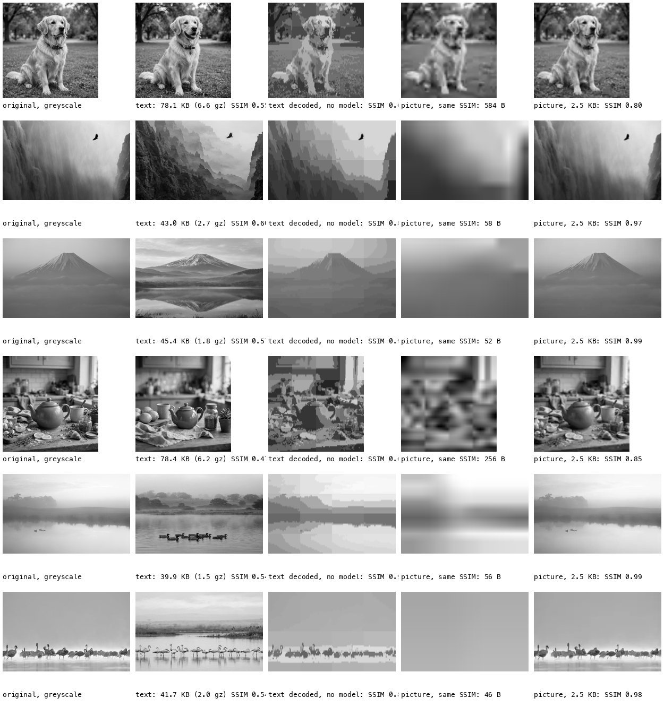
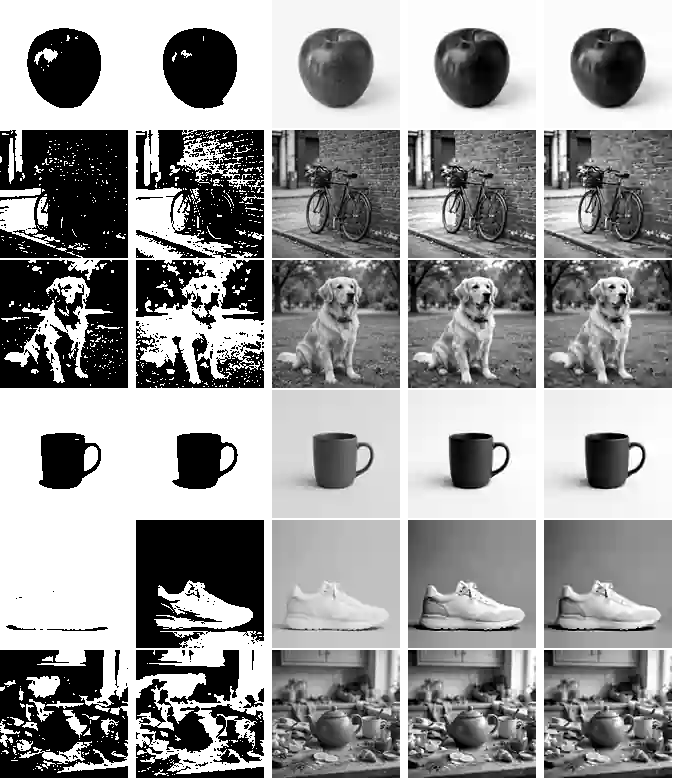
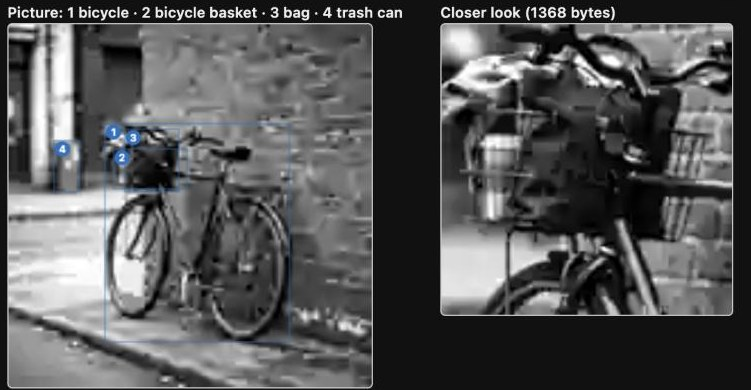

# MapsImagesText

**Pictures for people who can only receive text.** A server with a good connection does the heavy work: reading an emergency alert, looking at a photo, reading the weather radar, routing on street data. It sends back text that still works as a picture, a map or sketch drawn in characters. Each reply comes in several sizes, and the person gets the richest one their connection can carry.

| Version | Channel | What arrives | Typical size |
| --- | --- | --- | --- |
| **Low data** | SMS on an iPhone | the message + a small map in characters that line up in iPhone Messages | 6 to 12 SMS |
| **Medium data** | WhatsApp (monospace text) | the message + a 58-column map or drawing | 0.4 to 1.1 KB compressed |
| **Small picture** | a slow connection | a 400 px WebP drawn for that size | 4.5 to 23 KB |
| **High data** | a working connection | a picture map, or the photo itself | 50 to 180 KB |
| **Kit** | plain SMS + a page saved on the phone beforehand | the words + codes the page turns into a real map, a zoomable photo, a GPX route | 2 to 16 SMS |

Built on the Meta Model API:
- **Muse Spark** plans, writes and searches the web.
- **SAM 3.1** finds objects in photos.
- **Muse Image** draws the step pictures (and made the test pictures).
- **Muse Wonder** checks the pictures.

## What you can ask

Send one message (plus GPS, optionally a photo). Muse Spark picks the tools:

| Message | What comes back |
| --- | --- |
| an emergency alert (fire, gas leak, wildfire, flood) | the fixed, tested reply: are you affected, what to avoid, which way out, with a map |
| "Walk me to the Colosseum" | one step at a time on real street data, re-sent as you move |
| "Is it going to rain?" | the latest radar and a 2-hour forecast as text |
| a photo that won't download + "what is this?" | a description and the main object's outline in characters |
| "How do I shut off the gas?" | numbered steps from cited web sources, then checked before/after pictures where they help |

Every map shows **only what the reply is about**: the route, the streets it uses, closures and the danger zone's edge. Everything else is left blank, so the way to go is the first thing you see.

## How it works



Three ideas hold it together:

1. **Tools return two things.** A short summary goes to the model ("1479 m, 20 min, no rain in the next 2 hours"). The bulky result (a street network, a route, a radar grid) is kept for drawing, so the model never reads thousands of road points.
2. **One Scene, every drawing.** Each result becomes a `Scene`: you, the roads, closures, the danger zone, the goal and the route. Every version is drawn from that same Scene, so the SMS map, the WhatsApp map and the pictures always show the same route.
3. **The model plans and words; code computes and draws.** Distances, routes, closures, maps and legends are code. Muse copies numbers and street names exactly as written, and code converts them (letting the model convert made the zone's radius change from run to run). Emergency alerts always go through one fixed pipeline, whose text is used as it is.

Everything slow or flaky is cached or has a fallback. With no model key the router uses keyword rules, regex parsing and template text. A failing tool comes back to the model as an error it can work around. With no road data, routing uses aerial imagery only.

## Emergency alerts

The alert is parsed (Muse, with a regex fallback). The incident is located where its two streets cross in OpenStreetMap; the geocoder alone was 600 m off. If you're close, the server routes you out on a grid: roads are cheap, closed stretches cost 60×, and cost rises toward the hazard. It then draws the map. Someone far away gets one line. Someone inside the zone gets a first line to act on, e.g. `GO EAST NOW toward Westwood Recreation Center.`

```bash
python3 main.py samples/nyc_fire.txt --at 40.75491,-73.97441 --laptop 58
```

Low data, 12 SMS (the NYC samples are fictional drills):

```
FDNY responding to 5-alarm fire at 5 Av and W 47 St.
Fire incident 400 m from you.
Avoid 5 Av (W 42 St to W 50 St).
Expect road closures and smoke.

MAP (uptown is up):
=================== 51 St
  |     |     |     |     |  
=====×============= 50 St
  |    ×    |     |     |  
=====×============= 49 St
  |    ×    |     |     |  
=====×============= 48 St
  |    ×    |     |     |  
=====#========= 🔴 == 47 St
  |    ×    |     |     |  
=====×============= 46 St
  |    ×    |     |     |  
=====×============= 45 St
  |    ×    |     |     |  
=====×============= 44 St
  |    ×    |     |     |  
=====×============= 43 St

# fire: AVOID
× road closed: AVOID
= open road
🔴 you
Avenues left to right: 6 Av, 5 Av, Madison, Park, Lex
```

The WhatsApp version draws the avenues, your street, the closure and the zone (edge `░`, worst part `▓`) in 58 columns. The pictures draw side streets as faint grey context:

 

## Walking directions abroad

This is for someone roaming on a capped plan. Asked directly, Muse gives directions from memory, and some of its turns were wrong. Here the route comes from street data and Muse only rewords it. Each message carries the minimum:
- the current step, as far as the next intersection;
- which way to turn there;
- a landmark to look for;
- a map of just that stretch.

The streets are downloaded once, and each new GPS fix re-routes in about a second. On the same street with more than 80 m to go, the update is a single line.

```
Castelo de São Jorge: 0.7 km, about 9 min.
Now: head E on Calçada do Carmo for 120 m, to the next corner.
Then turn left onto the path ahead at Bebedouro dos Anjinhos (fountain).

MAP (north is up):
              
=             
 🔴         === 
=> v  =>>>>>>>Λ 
 =>>>Λ   =¤   
              
              

= open road
< > Λ v route
🔴 you
¤ Bebedouro dos Anjinhos
```

## Photos that won't load

Muse Spark describes the photo and names its main object. SAM 3.1 finds that object and gives its exact mask. The outline is traced with marching squares in `─ │ ╭ ╮ ╯ ╰` (58 columns for WhatsApp); SMS gets a 24-column silhouette, but only when Muse can still recognise it. For WhatsApp, Muse lists up to five things and SAM outlines them all. Before sending, a fresh Muse call sees only the drawing and has to recognise what's in it. If it doesn't, the server redraws up to three times. A higher-detail version shades every part by tone and lets you zoom into one.

A teapot on a cluttered counter: the lid knob, the spout and the handle with its hole, and none of the counter:

```
                           ╭───╮
                           │   ╰╮
                      ╭────╯    ╰───╮
                  ╭───╯             ╰───╮
  ╭──────╮       ╭╯                     ╰╮ ╭─────────╮
  ╰─╮    ╰╮    ╭─╯                       ╰─╯  ╭────╮ ╰╮
    ╰─╮   ╰─╮╭─╯                             ╭╯    ╰╮ ╰╮
      │     ╰╯                               ╰╮     │  │
      ╰╮                                      │     │  │
       │                                      ╰╮   ╭╯ ╭╯
       │                                       │ ╭─╯ ╭╯
       ╰╮                                      ╰─╯ ╭─╯
        ╰─╮                                     ╭──╯
          ╰─╮                                 ╭─╯
            ╰─╮                             ╭─╯
              ╰─╮                          ╭╯
                ╰─╮                      ╭─╯
                  ╰───╮              ╭───╯
                      ╰──────────────╯
(outline of teapot, found by SAM 3.1)
```

## How picture compression works

A photo has to reach a phone that can't download it. We tried three ways of carrying it, in this order.

**1. Draw it in characters.** The server draws the photo as text that any messaging app can carry:
- **Low detail:** the main object's outline (above).
- **High detail:** every part, from SAM masks, shaded by tone (`evac/tonal.py`). The subject stays dark and the background light.
- **Zooms:** a part redrawn from its own crop of the full-size photo.

The high-detail drawing of the dog, before and after making the subject stand out (over 36 photos the subject is now darker than its background in 34, up from 16):



The drawing carries *where things are and how light or dark they are*; the words carry *what it is and its colours*. Each drawing ships its own tone legend, so the receiver can rebuild the photo in two ways (`evals/photo_eval.py`, `evals/RESULTS.md`):
- **Decoding the text to grey, with no model.** One drawing gets 19% of the way from flat grey to the photo; with every zoom, 54%.
- **Asking Muse Image to recreate it.** Given the raw characters, it copies the glyph texture, so it is given the decoded grey instead. With the caption, its recreation matches the photo's layout at r 0.52; with every zoom, r 0.75 (the caption alone: 0.37).

Below, each row shows: the photo; every zoom decoded; Muse Image from the caption only, the drawing only, the drawing with its key, and the zooms' rebuild with the key. The dog, the eagle and Mt Fuji land in the right place; the teapot's clutter doesn't:


**2. Measure it as a codec.** `evals/compress_compare.py` sends the whole text payload for each of 36 photos (base drawing, every zoom in greedy order, the key) and scores the rebuilt picture against the greyscale photo with pixel measures only (SSIM, PSNR). Medians:

| What is sent | Size | SSIM (256 px) |
| --- | --- | --- |
| All zooms + key, decoded back to grey | 48 KB of text, 2.9 KB gzipped | 0.76 |
| The same text, recreated by Muse Image | same | 0.45 |
| A greyscale picture of about 300 bytes | 286 B | 0.72 |
| A greyscale picture the size of the gzipped text | 2.3 KB | 0.94 |



**As compression, text loses to a picture by one to three orders of magnitude.** A picture of about 300 bytes matches everything the text carries. The image model makes things worse, not better: it invents texture that isn't in the photo. So the text drawings are worth it only for the channel (they need no app and no decoder). Wherever a few hundred bytes of picture can get through, the picture wins.

**3. Send the picture itself, as text.** That is what the [offline kit](#the-offline-kit) does. The picture is 128 px, base64 inside an ordinary SMS, decoded by the browser:
- **Photos:** greyscale WebP at quality 5, contrast stretched: 284 to 1,400 bytes (3 to 14 SMS) for the six samples.
- **Line drawings:** 1-bit PNG (the step pictures), which the kit can compare pixel by pixel.
- **Zooms:** cropped from the full-size original the server keeps. A zoom shows detail the 128 px picture never had, at the cost of one more picture.

Why greyscale WebP and not black and white, on the six samples at 128 px: 1-bit PNG at a fixed threshold, 1-bit at Otsu's threshold, then WebP at quality 20, 10 and 5. They cost about the same, but in black and white the bicycle turns to noise against the brick wall and the white sneaker disappears:



## How-to answers and pictures (experimental)

"How do I shut off the gas at my meter?" gets numbered steps at once, written by Muse Spark from the Meta Model API's built-in web search. A step is marked confirmed when a cited source covers it, the sites are named, and the local emergency number is filled in. Pictures follow later, and only where they help:
- **What's drawn:** before and after pictures of the object a step changes. Muse Image draws them in black and white, with no hands, bodies or arrows.
- **Checks:** Muse Wonder (a different model) checks that the device looks the same everywhere and that the change is clear. This check agreed with hand labels on 15 of 19 pairs.
- **Dropped:** web image search, pictograms, drawn hands and bodies, and arrows were all tried and dropped.

## Weather radar

The server reads RainViewer's latest radar frame, mapping its colours back to rain strength. The frame from 40 minutes earlier gives the rain's direction and speed, and Open-Meteo gives the next 2 hours at your spot. It answers: is it raining on you, where is the nearest rain, which way is it moving, and will it rain later. The reply comes as an 18-column SMS grid, a 58-column shaded map with a 2-hour sparkline, and a radar picture.


## The offline kit

A text map is limited to what characters can show. The **kit** is a single web page (`sim/kit.html`, 27.5 KB gzipped) that a person saves on their phone once, before they need it. After that it works with no connection. The server puts short codes inside an ordinary SMS, and the kit turns them back into what text can't show. Decoding uses only what the browser already has (PNG and WebP, deflate, Ed25519 signatures).

```
#P7k.2/14:3DQwdsDX9WFdO8yf…:df2e#     type P (picture), id 7k, part 2 of 14, base64, CRC-16
```

- **Maps** that the kit draws properly: streets, the zone, closures, the route.
- **Signed alerts:** the kit says *Genuine* or *NOT genuine*, so a changed word is caught.
- **Photos you can zoom into.** A photo arrives as a 128 px greyscale WebP (see [how picture compression works](#how-picture-compression-works)). Drag a box or tap a numbered part (SAM names them), and the kit writes a one-SMS reply such as `ZOOM 7k 2`. The server crops its full-size original, and the kit pastes the close-up over the picture.
- **Routes that open in a map app:** the whole walk as an encoded polyline, which the kit turns into a GPX file for Organic Maps or OsmAnd to navigate offline.
- **Words with accents.** One character outside the basic SMS alphabet (ã, ç, ê) cuts every SMS from 153 to 67 characters; packing the words keeps them at 153.
- **A phrasebook** of checked how-to pictures already inside the kit, so only an id travels.
- **From the phone:** photo codes, check-ins with GPS, `RESEND` for lost parts, and a QR code to pass a message to a phone with no signal.

### Examples

**A photo, then a closer look.** The Photo tab's bicycle, as the kit message (Muse described it; SAM 3.1 boxed and named its parts):

```
Photo: A black bicycle with a front basket is parked on a sidewalk leaning against a red brick wall.
- The bicycle has a wire front basket holding a dark blue bag and a tan cloth
- It is parked on a concrete sidewalk next to a curb on a street
- The wall is made of weathered red bricks
#Pna.1/14:UklGRmYFAABXRUJQVlA4…AoN0:ca7e#     ← "UklGR…" is "RIFF": a WebP
   … 12 more parts …
#Pna.14/14:grGXKoDEyW5yeDCeCll…AA==:10c0#
#K0n.1/2:eyJpIjoibmEiLCJrIjpbW…YW4i:3280#      ← the named parts
#K0n.2/2:LDE2LDQxLDksMThdXX0=:4585#
                                                 17 SMS
```

The person taps part 2 in the kit, which writes the one-SMS reply `ZOOM na 2`. The answer is `Closer look at bicycle basket (part 2) in picture na:` and 14 parts of `#Z2z…`, a 1,368-byte WebP cropped from the original. The kit draws the picture with its numbered parts (left) and the close-up (right), and pastes the close-up over the picture:



**A walking route.** Rossio to Castelo de São Jorge. The words travel as a `T` code (the "ã" would make the plain SMS UCS-2), then the step's map and the whole route:

```
#Tue.1/2:LY4xCsJAEEX7nOKXCrJEG…uGoS:8ea1#    ← "Castelo de São Jorge: 0.7 km, about 9 min. Head E on Calçada do Carmo…"
#Tue.2/2:Tq665CQYuLMi//cnWQCF3…Cw==:7c1b#
#Mac.1/3:VZG/TsMwEIdfxbr5ItlOm…MXNm:b1ba#    ← the step's map
#Mac.2/3:yawiNc9rduiMlDuELrSAt…600o:3ca6#
#Mac.3/3:JTZuEFvbeiduHuk5nSHlc…P34B:79de#
#G7c.1/1:c04sLknNyVdISVUIPrw4X…AA==:2888#    ← the route: walk-to-Castelo-de-Sao-Jorge.gpx, 28 points
                                               6 SMS (the plain reply with its text map: 6)
```

**Words with accents.** "Comment couper l'eau en cas de fuite ?" from Paris: Muse's French answer is 5 SMS as plain text (UCS-2) and 2 SMS as a `T` code.

**Measured** (`evals/kit/measure.py`, full table in [`evals/kit/RESULTS.md`](evals/kit/RESULTS.md)):
- **Overall:** alerts, a walk and three answers take 44 SMS plain and 33 with the kit.
- **Biggest wins:** the Manhattan fire alert (12 → 6 SMS) and a French answer (5 → 2).
- **Against pictures over data:** a kit reply is 13–20× smaller than the small picture.
- **Zoom:** a close-up of a quarter of a photo takes 3–19 SMS, against 14–146 SMS for the whole photo at that detail.
- **Payback:** the page pays for itself after about 200 SMS saved.

## Why the text maps line up

- **SMS:** iPhone Messages uses SF Pro, a proportional font. The SMS maps use only characters measured to be exactly one digit wide (`= # + < > 0 $ ¤ £ ¥ ×`, figure spaces for blanks). Each row's width error is logged as `worst row drift`, which must stay under about 0.07 cells.
- **WhatsApp:** it shows monospace text but can't colour it, so its maps use box drawing (`━ ┃ ╋`) and shading (`░▒▓█`), all one cell wide in Menlo.
- **"You":** the 🔴 dot is the only colour.


## Try it

```bash
python3.12 -m venv .venv
```

```bash
.venv/bin/pip install -r requirements.txt
```

Put a Meta Model API key in `.env` (git-ignored) as `LLAMA_API_KEY=...`. Without one, everything falls back to keyword routing, regex parsing and template text.

```bash
.venv/bin/python sim/server.py
```

The simulator runs at http://127.0.0.1:8765. It has tabs for emergencies (three people with their own GPS), photos, radar, walking (with simulated GPS moves) and "ask anything". Every reply is shown in each of its versions with real sizes, including how the kit draws it.

From the command line:

```bash
.venv/bin/python main.py --ask "Is it going to rain on my walk to the Colosseum?" --at 41.9010,12.5016
```

```bash
.venv/bin/python main.py samples/nyc_fire.txt --at 40.75491,-73.97441 --laptop 58 -v
```

```bash
.venv/bin/python main.py --walk "Castelo de São Jorge, Lisbon" --at 38.7139,-9.1406
```

`--photo some.jpg` and `--radar LAT,LON` run the other modes.

## Code

| Area | Files |
| --- | --- |
| Router and tools | `evac/router.py`, `evac/tools.py`, `evac/llm.py` |
| Scene and drawing | `evac/scene.py`, `evac/focus.py`, `evac/render.py`, `evac/textmap.py` (SMS), `evac/laptopmap.py` (WhatsApp), `evac/imagemap.py` (pictures) |
| Emergency | `evac/pipeline.py`, `evac/notice.py`, `evac/grid.py`, `evac/segment.py`, `evac/imagery.py` |
| Walking | `evac/directions.py`, `evac/osm.py`, `evac/geo.py` |
| Photos | `evac/photo.py`, `evac/sam.py`, `evac/sketch.py`, `evac/tonal.py`, `evac/zooms.py` |
| How-to | `evac/howto.py`, `evac/illustrate.py`, `evac/verify.py`, `evac/museimage.py` |
| Radar | `evac/radar.py` |
| Kit | `evac/codes.py`, `evac/smsimage.py`, `sim/kit.js`, `sim/kit.html`, `sim/pack.json` |
| Simulator | `sim/server.py`, `sim/index.html` |
| Evals | `evals/` (photo drawings, emergency pictures, kit sizes) |

`CLAUDE.md` has the details of how the pieces connect.

## Data sources and limits

Roads and places © OpenStreetMap contributors (via Overpass); geocoding by Nominatim; aerial imagery © Esri; radar © RainViewer; forecasts by Open-Meteo. How-to steps name the sites they came from.

- **Not checked on real phones:** the maps have not been checked on a real iPhone or in WhatsApp, and the GPX files not in a map app on a phone.
- **Overpass:** the free servers are slow, 30 s to 2 minutes for a new area. Alerts wait at most 15 s for streets, then route on aerial imagery alone.
- **SMS length:** replies are 6 to 12 parts, and a photo with tones in the kit is 3–14 SMS.
- **The kit must be saved ahead of time,** and pasting a message into it is a step people have to learn.
- **The how-to pictures are experimental:** few steps qualify, the checks are noisy, and the test pictures are renders, not real photos.
