# MapsImagesText

**Pictures for people who can only receive text.** A server with a good connection does the heavy work (reading an emergency alert, looking at a photo, reading the weather radar, routing on street data) and sends the result back as text that still works as a picture: a map or sketch drawn in characters. The same reply exists in four sizes, and the person gets the richest one their connection can carry.

| Version | Channel | What arrives | Typical size |
| --- | --- | --- | --- |
| **Low data** | SMS on an iPhone | the message + a small map in characters that line up in iPhone Messages | 6 to 12 SMS parts (~1 to 1.7 KB) |
| **Medium data** | WhatsApp (any app that shows monospace text) | the message + a 58-column monospace map | 2 to 5 KB of text, 0.4 to 1.1 KB compressed |
| **Small picture** | a slow connection | a 400 px WebP map drawn for that size, or the photo/radar shrunk | 4.5 to 23 KB |
| **High data** | a working connection | an ordinary picture map, or the photo itself | 50 to 180 KB |

Ask it anything in one message; **Muse Spark** decides which tools to call:

- "Is it going to rain on my walk to the Colosseum?" → radar + walking route → one reply with the first step and its map
- "How do I walk from the Pantheon to the Colosseum?" → a walking route from the Pantheon, not from where you are
- an emergency alert (fire, gas leak, wildfire, flood) → the fixed, tested emergency reply: are you affected, what to avoid, which way out
- "my friend sent me this, what is it?" + a photo that won't download → a description + the photo drawn in text
- "How far is the Trevi Fountain?" → a one-line answer

Every map and drawing shows **only what the reply is about**: the route, the streets it uses, the closures and the zone's edge. Everything else is left blank, so the way to go is the first thing you see. Walking directions go one step at a time: only the current step, as far as the next intersection, which way to turn there and a landmark to look for, with a map zoomed to just that stretch. The next step comes as you move. A photo of one object becomes that object's outline, drawn as wide as the maps.

Built on the Meta Model API: Muse Spark plans and words, SAM 3.1 finds objects in photos, Muse Image made the test pictures.

Contents: [Architecture](#architecture) · [The router](#the-router-one-message-in-muse-picks-the-tools) · [Tools](#tools) · [Scene and renderers](#scene-one-description-four-drawings) · [Only what matters](#showing-only-what-matters) · [Emergency](#emergency-alerts) · [Photo](#photos-that-wont-load) · [Radar](#weather-radar) · [Directions](#walking-directions-abroad) · [Text-map rules](#why-the-text-maps-line-up) · [Simulator](#try-it-the-simulator) · [Command line](#run-it-from-the-command-line) · [Code](#code) · [Limits](#known-limits)

## Architecture

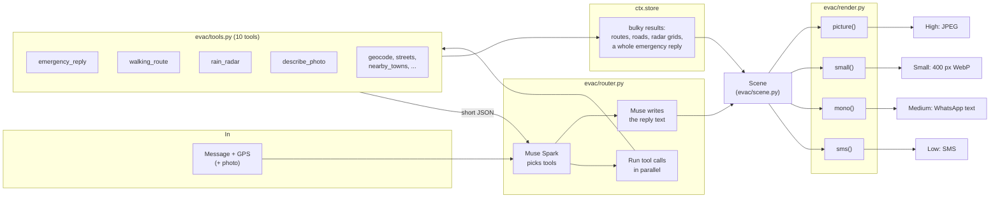

Three ideas hold it together:

1. **Tools return two things.** A short JSON summary goes back to Muse (a distance, the steps, "no rain in the next 2 hours"). The bulky result (a street network, a route, a radar grid, a whole emergency reply) stays in the request's `ctx.store`. The model never has to read thousands of road points, and what gets drawn is exactly what the tools found.
2. **One Scene, four drawings.** Whatever was asked, the result becomes one `Scene`: where you are, the roads, closures, danger zone, the goal (a shelter or a destination), the route, terrain and the text. Each version is drawn from that same Scene by `evac/render.py`, so the SMS map, the WhatsApp map and the pictures always show the same route.
3. **The model plans and words; code computes and draws.** Muse chooses tools and writes the message. Distances, routes, closures, every map and legend are code. For emergencies the model only routes the alert to the fixed, tested reply and never rewrites it.

Everything slow or flaky is cached (`cache/osm/` for road data) or has a fallback: no model key means keyword routing, regex alert parsing and template text; a failed tool comes back to the model as an error it can work around; no road data means routing on imagery only.

## The router: one message in, Muse picks the tools

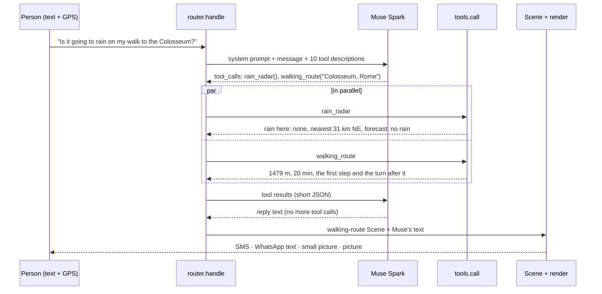

`router.handle(message, you, image=None)`:

1. **Plan.** Muse Spark gets a system prompt (the person's GPS, whether a photo is attached, "keep every number exactly", "never list every forecast value", "for any emergency alert call `emergency_reply` and nothing else") and the tool descriptions. It answers with tool calls. Up to 3 rounds, so it can look something up and then act on it.
2. **Run.** Tool calls in a round run in parallel threads (radar and routing each take seconds). Each result goes back to Muse as a `tool` message, truncated to 4,000 characters.
3. **Write.** When Muse stops calling tools, its reply is the message text. For an emergency the fixed reply's text is used verbatim instead.
4. **Draw.** The router picks what to draw from what the tools kept, in this order: an emergency reply, a walking route, the radar, a photo. Map scenes are drawn by `evac/render.py`; radar and photos still bring their own four versions until they become Scenes too.

Without a model key, keyword rules pick one tool (`_run_rules`): a photo → `describe_photo`; a long text mentioning an alert, fire, flood, leak or evacuation → `emergency_reply`; "rain", "radar" or "weather" → `rain_radar`; "walk to X" or "directions to X" → `walking_route`.

### Real runs

Rome Termini, "How do I walk from the Pantheon to the Colosseum?" (16.7 s). Muse passes the Pantheon as the walk's `start`; before, the tool had no start, so the route began at Termini while the reply said "from the Pantheon". Only the first step goes out:

```
tools called: walking_route(Colosseum, Rome, Pantheon, Rome)

Walk from Pantheon to Colosseum is 1664 m, about 22 min.
Head SE on Via della Palombella for 70 m, to Piazza della Minerva.
Then keep straight onto Piazza della Minerva.

MAP (north is up):
              
  v  🔴           
  v             
  v             
 >>>>>>>>>>   
 =============
              

= open road
< > Λ v route
🔴 you

┌─ ↑ N ────────────────────────────────────────────────────┐
│                                                          │
│         🔴 YOU                                           │
│        ←↓                                                │
│       ←↓                                                 │
│      ←↓                                                  │
│      ↓                                                   │
│      ↓                                                   │
│      ↓                                                   │
│      ↓                                                   │
│      ↓                                                   │
│      ↓→                                                  │
│       ↓→                                                 │
│         ↘                                                │
│         ↓→                                               │
│          ↓→                                              │
│            ↘→→→→→→→→→→→→→→→→→→→→→→→→→→→→→→→→→→→→→→→      │
│           Via della Palombella   Piazza della Minerva    │
│      ──────────────────────────────╱──────────────────── │
│                                  ╱╱╱   Colosseum 1.5 km ⌂│
│                                                          │
└─ ├────────────┤ 20 m ────────────────────────────────────┘

🔴 you
→ route
⌂ destination
```

Rome Termini, "How far is the Trevi Fountain?":

```
tools called: geocode(Trevi Fountain)

Trevi Fountain is 1516 m to the W.
About a 20 min walk from you.

1.9 s; map: None
```

A photo attached, "my friend sent me this, what is it?" (5.9 s). The flamingos are a small part of the photo, so the drawing zooms in on them:

```
tools called: describe_photo()

A large flock of pink flamingos wades through shallow, misty water in soft golden light.
About two dozen standing together.
Hazy sunrise or sunset glow with mist over the water.

    #
 ###### #######
 ###  #########
(outline of the main subject, zoomed in: left flamingos, central flamingos, right flamingos)

            ────
  ──────────   ─╲   ─        ────
 │╱             ╲────     ───   ─────────────────
  ╲           ───│  ╲   ──                      ╲
  │          ╱   ╲  ╲╲──                        │
  ╲╲ ─────  ╱    ╲╲──│  ───────────             │
   ╲─    ───╱        ───          ────────   ───╱
                                         ────
(outline of the main subject, zoomed in: left flamingos, central flamingos, right flamingos)
```

Before building the router, Muse's tool choice was tested on seven requests: it picked the right tools every time, in 0.6 to 1.3 s per decision.

## Tools

`evac/tools.py`. A function becomes a tool with one decorator line: a plain-language description and its parameters, which become the JSON schema Muse reads.

```python
@tool("Walking route from the person to a destination along real streets and footpaths, with turn-by-turn steps.",
      destination=("string", "Where to, e.g. 'Colosseum, Rome'", True))
def walking_route(ctx, destination):
    ...
    ctx.store["walking_route"] = res          # bulky: kept for the Scene
    return {"distance_m": ..., "minutes": ..., "steps": ...}   # short: goes to the model
```

| Tool | What it returns to the model | What it keeps for drawing | Backed by |
| --- | --- | --- | --- |
| `emergency_reply(text)` | affected?, inside the zone?, the message, steps | the whole emergency reply (all four versions) | `pipeline.run` |
| `read_alert(text)` | hazard, order, place, radius as written, shelters, closed segments | the parsed alert | `notice.parse` (Muse, regex fallback) |
| `locate_incident(place)` | lat/lon, distance, direction | | `pipeline.locate` (intersections from road data) |
| `walking_route(destination, start?)` | distance, minutes, the current step and the turn after it, where the destination is | the trip and the step's Scene | `directions.run` |
| `streets(radius_m, walking)` | how many streets, the main ones | the street network | Overpass |
| `geocode(query)` | lat/lon, distance, direction | | Nominatim |
| `nearby_towns(radius_km)` | towns with distance and direction | the town list | Overpass |
| `rain_radar()` | rain over you, nearest rain, motion, forecast summary | radar grids and its four versions | RainViewer + Open-Meteo |
| `rain_forecast(lat, lon)` | 15-minute rain for 2 hours at one spot | the forecast | Open-Meteo |
| `describe_photo()` | caption, details, the main object's name | the description | Muse Spark (vision) |

`tools.call(ctx, name, args)` never raises: a missing argument, an unknown tool or a failing service (Overpass timing out, for example) comes back as `{"error": ...}`, which the model reads and works around. Every call is logged in `ctx.log`.

## Scene: one description, four drawings

`evac/scene.py` is what a mode produces and every renderer reads. Renderers never fetch data or route; they draw what is in the Scene.

| Field | Meaning |
| --- | --- |
| `you` | the reader's GPS |
| `center` | where the view is centred (None: on you). Walking maps are fitted to the route instead |
| `half_m` | half the width of the view, in metres |
| `text` | the message (instructions, directions, Muse's reply) |
| `roads`, `closures` | OSM roads; closed segments `{road, from, to}` |
| `hazard`, `zone` | e.g. `"fire"`; `((lat, lon), radius_m)` of the danger zone. No zone = plain directions |
| `goal` | `(name, (lat, lon))`: a shelter, or a destination when there is no zone |
| `route` | `[(lat, lon), ...]` from you to the goal or to safety |
| `aerial`, `masks` | the aerial photo of the view and its terrain masks (water, trees) |
| `walk` | routed on foot: off-street cells cost more, footpaths aren't drawn |
| `street_grid` | a Manhattan intersection: the SMS map uses the avenue/street grid |
| `title`, `summary` | the picture's banner |
| `cols` | width of the canonical frame (the SMS routing grid, 40 columns) |
| `focus` | the roads to draw, picked by `evac/focus.py` (None: every road) |
| `marks` | `[(n, (lat, lon))]`: where step n starts, drawn as a number on the route |

`evac/render.py`:

| Function | Version | How |
| --- | --- | --- |
| `sms(scene)` | low data | `textmap.py`: Manhattan street grid, or the routing grid shrunk to 14 to 20 columns; legend; returns the full SMS. A focused scene draws only its roads and the zone's edge |
| `mono(scene, cols)` | medium data | `laptopmap.py`: line-drawn roads, labels, route arrows and step numbers, 58 columns for WhatsApp. A focused scene: only its roads, the zone as an edge (░) and its worst part (▓), no trees, empty rows dropped |
| `small(scene)` | slow connection | `imagemap.py` at 400 px, WebP quality 50: **drawn** at that size, so labels stay readable |
| `picture(scene)` | high data | `imagemap.py` at 800 px, JPEG: an agency-style map; a focused scene draws its roads in full and the rest as faint grey context, with numbered step markers |

Moving the emergency and directions modes onto the Scene was checked against the previous code on five cases (NYC fire, gas leak, wildfire, flood, Lisbon walk) with the model switched off: the SMS replies and the pictures came out byte-for-byte identical. The WhatsApp maps changed only where they now draw the shared route instead of computing their own.

## Showing only what matters

The first versions drew every road in the frame. In Lisbon's old town the WhatsApp map had about 950 line characters and the route was hard to find; the wildfire map shaded the whole zone and every patch of trees. Someone reading a map in a hurry, or in a panic, needs three things: **where they are, which way to go, and what to avoid.** So every Scene now carries `focus`: the few roads worth drawing, chosen by `evac/focus.py`, and every version draws only those.

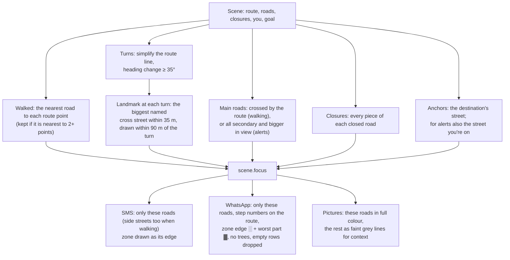

Choices that mattered:

- **The nearest road, not every road nearby.** Old-town streets run a few metres apart, so "roads within 14 m of the route" kept 75 roads in Lisbon. Counting only the nearest road at each route point keeps 38.
- **Streets matched by name are cut to the area that matters.** A landmark is drawn only within 90 m of its turn. Before that, "Calçada do Carmo" pulled in its whole length across the download.
- **The view is fitted to what matters, with no fixed zoom.** A walking step's map is framed around you, the step, a third of it past the turn (15 to 80 m) and its landmarks, with a margin of 15% of what it shows. A 20 m step and a 900 m one are framed the same way; the old frame was a fixed square centred on you, half of it behind you.
- **One step shows only its own streets.** A step map keeps only the street you're on and the one you turn into, clipped to the part near the route. Praça Dom Pedro IV is mapped as one closed loop, so without the clip the whole square was drawn around a 20 m step.
- **Scales follow the data.** The distance at which a route point counts as "on" a street scales with how far apart the route's points are, and the routing grid targets 8 m cells. At a fixed 160 columns a 1.5 km walk in Rome had 25 × 49 m cells, the route sat 22 m off every street and the step map drew no streets at all.
- **Alerts keep the main roads.** For orientation, an alert map keeps every secondary or bigger road in view (avenues, Sunset Blvd, PCH) and the street you're on. It drops side streets, tree dots and the zone fill. Someone inside the zone also gets a first line to act on: `GO EAST NOW toward Westwood Recreation Center.`

Measured on the same inputs with the model off (non-blank characters in the 58-column WhatsApp map):

| Map | Before | After |
| --- | --- | --- |
| Lisbon walk, Rossio → castle (first step) | 957 | 224 |
| Rome walk, Termini → Colosseum (first step) | 1264 | 217 |
| Wildfire, inside the zone | 1387 | 624 |
| NYC gas leak | 742 | 586 |
| NYC fire | 713 | 647 |

The SMS maps are still within 0.04 cells of alignment (`worst row drift`) in every case.

### Choosing the version

The simulator's **Person's connection** setting is a data budget per message: no data (0) → SMS; a trickle (~2 KB) → WhatsApp text, counted at its compressed size; slow (~25 KB) → the small picture; good → the full picture. The richest version that fits is highlighted as "sent on this connection". On a phone the app could measure its own speed; over SMS the server can't, so this is a per-person setting.

**Why draw small pictures instead of shrinking big ones:** shrinking the 800 px NYC map to 200 px gives 3.9 KB but its 11 px street names become unreadable smudges. Drawn at 400 px, text and lines keep their pixel size, fewer labels fit (biggest roads first, no overlaps), and the map stays legible at 17 KB. Photos and radar are pictures to begin with, so those are simply shrunk (4.5 KB for the radar, 3.5 KB for a misty photo).

## Emergency alerts

The one fixed path: `emergency_reply` runs `pipeline.run`, which is deterministic apart from Muse reading the alert and rewording the instructions.

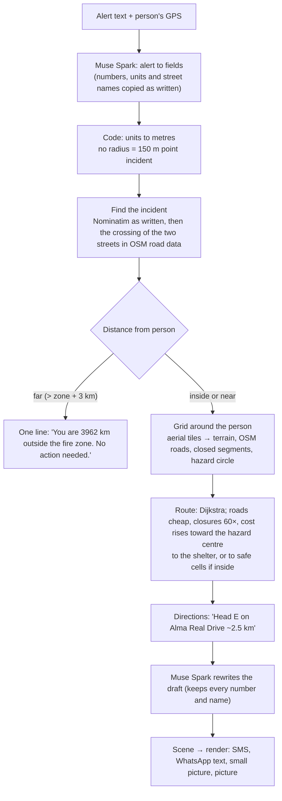

Details that matter:

- **The model copies, code computes.** Muse returns `{"value": 2, "unit": "mi"}` and street segments exactly as written; `notice._normalize` converts. Letting the model convert made the radius differ run to run, which changed the map area and missed the road cache.
- **Intersections come from road data.** "5 Av and W 47 St" is found where the two streets cross in OpenStreetMap; the geocoder alone was about 600 m off. The place is looked up as written first (biasing toward the reader once put a Manhattan fire in Los Angeles for a reader there).
- **Closures are segments.** "Avoid 5 Av between W 42 St and W 50 St" closes only that stretch, found by its two cross streets.
- **Routing** is Dijkstra on a grid whose cells are twice as tall as wide (like a character): roads cost 1, open ground 3, trees 4 (8 in a wildfire), buildings 12, water 30 (impassable outside wildfires), closures 60, and costs rise toward the centre of the hazard.
- **Muse runs with `reasoning_effort: minimal`**: the same answers in 1 to 2 s instead of 5 to 10 s.

Samples are in [`samples/`](samples/); the NYC alerts are fictional drills.

### NYC fire, you are 3 blocks east

```bash
python3 main.py samples/nyc_fire.txt --at 40.75491,-73.97441 --laptop 58
```

Low data (12 SMS parts). The `+` area around the fire is gone; the closed avenue and the `#` are what to avoid:

```
FDNY responding to 5-alarm fire at 5 Av and W 47 St.
Fire incident 400 m from you.
Avoid 5 Av (W 42 St to W 50 St).
Expect road closures and smoke.

MAP (uptown is up):
=================== 51 St
  |     |     |     |     |  
=====×============= 50 St
  |    ×    |     |     |  
=====×============= 49 St
  |    ×    |     |     |  
=====×============= 48 St
  |    ×    |     |     |  
=====#========= 🔴 == 47 St
  |    ×    |     |     |  
=====×============= 46 St
  |    ×    |     |     |  
=====×============= 45 St
  |    ×    |     |     |  
=====×============= 44 St
  |    ×    |     |     |  
=====×============= 43 St

# fire: AVOID
× road closed: AVOID
= open road
🔴 you
Avenues left to right: 6 Av, 5 Av, Madison, Park, Lex
```

Medium data (3.2 KB, 0.5 KB compressed). Only the avenues (main roads), your street, and the closed avenue are drawn; the zone is an edge `░` with its worst part `▓`:

```
FDNY responding to 5-alarm fire at 5 Av and W 47 St.
Fire incident 400 m from you.
Avoid 5 Av (W 42 St to W 50 St).
Expect road closures and smoke.

                            Lexington Av
 5th Av  Madison Av  Park Av            3rd Av        2nd Av
┌─ ↑ uptown ───────────────────────────────────────────────┐
│   ┃         ┃        ┃┃         ┃        ┃             ┃ │
│   ┃         ┃        ┃┃         ┃        ┃             ┃ │
│   ┃         ┃        ┃┃         ┃        ┃             ┃ │
│   ┃         ┃        ┃┃         ┃        ┃             ┃ │
│   ┃         ┃        ┃┃         ┃        ┃             ┃ │
│━━━×━━━━━━━━━╋━━━━━━━━╋╋━━━━━━━━━╋━━━━━━━━╋━━ 50th St ━━╋━│
│   ×         ┃        ┃┃         ┃        ┃             ┃ │
│   ×         ┃        ┃┃         ┃        ┃             ┃ │
│━━━×━━━━━━━━━╋━━━━━━━━╋╋━━━━━━━━━╋━━━━━━━━╋━━ 49th St ━━╋━│
│░░░×░░░░░    ┃        ┃┃         ┃        ┃             ┃ │
│░  ×     ░░  ┃        ┃┃         ┃        ┃             ┃ │
│░  ×       ░ ┃        ┃┃         ┃        ┃             ┃ │
│░ ▓×▓       ░┃        ┃┃    YOU  ┃        ┃             ┃ │
│░▓▓◆▓FIRE   ░┃        ┃╋────🔴───╋────────╋── 47th St ──╋ │
│░ ▓×▓       ░┃        ┃┃         ┃        ┃             ┃ │
│░  ×━━━━━━━━━╋━━━━━━━━┃┃         ┃        ┃             ┃ │
│━━━×     ░░  ┃       ━╋╋╋━━━━━━━━╋━━━━━━━━╋━━ 46th St ━━╋━│
│░░░×░░░░░    ┃        ┃ ┃        ┃        ┃             ┃ │
│━━━╋━━━━━━━━━╋━━━━━╋━━━━━╲╋━━━━━━╋━━━━━━━━╋━━ 45th St ━━╋━│
│   ×         ┃     ┃      ┃      ┃        ┃             ┃ │
│   ×         ┃     ┃      ┃      ┃        ┃             ┃ │
│   ×         ┃     ┃      ┃      ┃        ┃             ┃ │
│   ×         ┃     ┃      ┃      ┃        ┃             ┃ │
│   ×         ┃     ┃      ┃      ┃        ┃             ┃ │
│   ×         ┃     ┃      ┃      ┃        ┃             ┃ │
│   ×         ┃     ┃╲━━╋━━╋      ┃        ┃             ┃ │
│━━━╋━━━━━━━━━╋━━━━━━━━━╋━━━━━━━━━╋━━━━━━━━╋━━ 42nd St ━━╋━│
└─ ├───────────┤ 200 m ────────────────────────────────────┘

🔴 you
◆ incident   ░ edge of danger zone   ▓ worst of it
× road closed
━ main road   ─ street
Avenues run up and down, streets left and right.
```

Small picture (17 KB, drawn at 400 px) and full picture (89 KB). Side streets are faint grey lines; the avenues, the closure and the zone stand out:

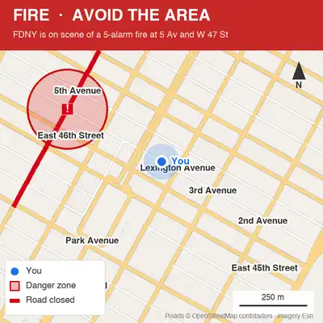 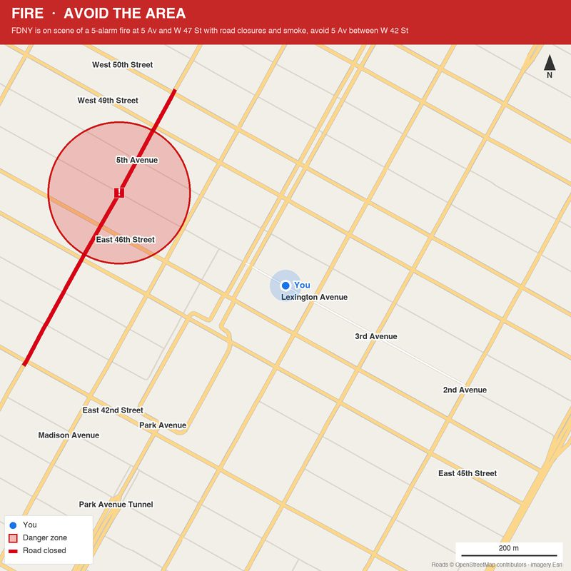

### NYC gas leak, a street closure

```bash
python3 main.py samples/nyc_gas_leak.txt --at 40.7560,-73.9740 -v
```
notice (llm): {'hazard': 'gas', 'order': 'avoid_area', 'zone_center_place': 'Lexington Av and E 51 St, Manhattan', 'shelters': [], 'avoid_roads': [{'road': 'E 51 St', 'from': 'Park Av', 'to': '3 Av'}], 'deadline': None, 'summary': 'Avoid E 51 St between Park Av and 3 Av in Manhattan due to a gas leak at Lexington Av and E 51 St.', 'zone_radius_m': None}
intersection Lexington Av & E 51 St found in road data at (40.7571285, -73.9719044) (geocoder said (40.756184, -73.972591))
user (40.756, -73.974), zone center (40.7571285, -73.9719044) r=150m, distance 216m, inside=False
closure '51 street': segment between cross streets
107 of 132 roads drawn
text map: 9 rows, worst row drift 0.04 cells 

Gas leak at Lexington Av and E 51 St.
You are 220 m from the incident.
Avoid E 51 St between Park Av and 3 Av.

MAP (uptown is up):
=============== 52 St
  |     |     |     |  
=====××××#××××= 51 St
  |     |     |     |  
=============== 50 St
  |     |     |     |  
=============== 49 St
  |     |   🔴  |     |  
=============== 48 St

# gas: AVOID
× road closed: AVOID
= open road
🔴 you
Avenues left to right: Madison, Park, Lex, 3 Av
```
notice (llm): {'hazard': 'gas', 'order': 'avoid_area', 'zone_center_place': 'Lexington Av and E 51 St, Manhattan', 'shelters': [], 'avoid_roads': [{'road': 'E 51 St', 'from': 'Park Av', 'to': '3 Av'}], 'deadline': None, 'summary': 'Con Edison and FDNY are responding to a gas leak at Lexington Av and E 51 St, avoid E 51 St between Park Av and 3 Av and expect delays.', 'zone_radius_m': None}
intersection Lexington Av & E 51 St found in road data at (40.7571285, -73.9719044) (geocoder said (40.7641117, -73.966817))
user (40.756, -73.974), zone center (40.7571285, -73.9719044) r=150m, distance 216m, inside=False
closure '51 street': segment between cross streets
text map: 13 rows, worst row drift 0.04 cells 

Con Edison and FDNY are responding to a gas leak at Lexington Av and E 51 St.
Gas incident is 220 m from you.
Avoid E 51 St between Park Av and 3 Av.
Expect delays.

MAP (uptown is up):
=============== 53 St
  |     |  ++ | ++  |  
=============== 52 St
  |     | +++ | +++ |  
=====××××#××××= 51 St
  |     | +++ | +++ |  
=============== 50 St
  |     |  ++ | ++  |  
=============== 49 St
  |     |   🔴  |     |  
=============== 48 St
  |     |     |     |  
=============== 47 St

# gas: AVOID
+ near the leak: stay clear
× road closed: AVOID
= open road
🔴 you
Avenues left to right: Madison, Park, Lex, 3 Av
```

### Wildfire, you are inside the zone

```bash
python3 main.py samples/palisades_fire.txt --at 34.0445,-118.5300 --laptop 58
```

Low data (9 SMS parts). Someone inside the zone gets one line to act on first:

```
GO EAST NOW toward Westwood Recreation Center.
EVACUATE NOW.
You are within 2 miles of Temescal Canyon Park wildfire.
Go to Westwood Recreation Center.
Head E on unnamed road ~210 m.
Head E on Alma Real Drive ~2.5 km.
Head E on 17th Street ~620 m.
Continue to Westwood Recreation Center (7.6 km E).
Avoid Sunset Blvd.
Avoid Palisades Dr.

MAP (north is up):
 ×××          
 ××+++++++ ×× 
 +××#### ××××× Sunset Blvd
~+=### 🔴 >>>+=  PCH
~+~######==+==
~~++~~~~+++===
~~~~+~~+~  ===

# wildfire: AVOID
+ evacuation zone: leave
× road closed: AVOID
= open road
~ water
< > Λ v way out
🔴 you
```

Medium data (3.1 KB, 0.6 KB compressed). At 142 m per character, side streets are left out; so are the tree dots and the zone's fill, leaving its edge `░`, its worst part `▓`, the closed roads and the way out:

```
GO EAST NOW toward Westwood Recreation Center.
EVACUATE NOW.
You are within 2 miles of Temescal Canyon Park wildfire.
Go to Westwood Recreation Center.
Head E on unnamed road ~210 m.
Head E on Alma Real Drive ~2.5 km.
Head E on 17th Street ~620 m.
Continue to Westwood Recreation Center (7.6 km E).
Avoid Sunset Blvd.
Avoid Palisades Dr.

┌─ ↑ N ────────────────────────────────────────────────────┐
│      ××××                                                │
│      × ××××××                                            │
│      ××      ××                                          │
│       ×××                                                │
│         ××         ░░░░░░░░░░░░░░                        │
│          ×    ░░░░░              ░░░░                    │
│          ×× ░░                       ░░░                 │
│          ░░×                            ░░        ××     │
│         ░  ××                        Sunset Blvd ××××××××│
│       ░░    ×                               ░  ×××       │
│      ░      ××                          ×   ××××         │
│      ░       ×     ×××××××××××         ××× ×  ░     ━━━━⌂│
│ Palisades Dr ×     ×     ▓▓╱╱×××      ×××××    ░ ╱╱╱━    │
│     ░       ×××   ×× ▓▓▓▓▓▓┃🔴 ×××  ××         ╱╱╱       │
│╱╱━━━━━╲     ××××××  ▓▓▓▓▓▓┃│▓→→→→ ×××        ╱╱╱         │
│≈≈≈≈░   ━━╲━╋╋━━━━━━━━╲▓▓▓◆╱▓▓▓▓ ↓→→→→→→→→→→→→→→→→→→      │
│≈≈≈≈░                 ╲╲╲╳╱▓▓▓▓▓            ┃   ░         │
│≈≈≈≈≈░                 ▓▓╲╲╲╲▓             ┃┃   ░         │
│≈≈≈≈≈░                       ╲━╲╲╲ PCH    ╱╱   ░          │
│≈≈≈≈≈≈░                          ╲╲╋╲   ╱╱╱    ░        ╱╋│
│≈≈≈≈≈≈≈░                            ╲╲╋╋╳     ░       ╱╱╱ │
│≈≈≈≈≈≈≈≈░░                             ╲╲╲╲ ░░      ╱╱╱ ╱╱│
│≈≈≈≈≈≈≈≈≈≈░                               ╲╲╳     ╱╳╳╲╱╱╱ │
│≈≈≈≈≈≈≈≈≈≈≈░░░                          ░░  ╲╲╋ ╱╱╱ ╱╳╳╲╱╱│
│≈≈≈≈≈≈≈≈≈≈≈≈≈≈░░░                   ░░░░      ╲╳╳ ╱╱╱ ╱╳╳╳│
│≈≈≈≈≈≈≈≈≈≈≈≈≈≈≈≈≈░░░░░░░░    ░░░░░░░            ╲╳╳ ╱╋╋╳╱╳│
│≈≈≈≈≈≈≈≈≈≈≈≈≈≈≈≈≈≈≈≈≈≈≈≈≈░░░░Santa Monica Freeway ╲╋╳━╳╳╳╱│
└─ ├────────────┤ 2 km ────────────────────────────────────┘

🔴 you
◆ incident   ░ edge of danger zone   ▓ worst of it
× road closed
→ way out
⌂ shelter
━ main road   ─ street
≈ water
```

## Photos that won't load

The simplest useful case is a photo of **one thing**: what is it, and what shape is it? So the drawing is just that object's outline, cropped to it and drawn as wide as the maps (58 columns for WhatsApp, 24 for SMS), with Muse's description above it. **Muse Spark names the object, SAM 3.1 finds it and gives its exact shape.**

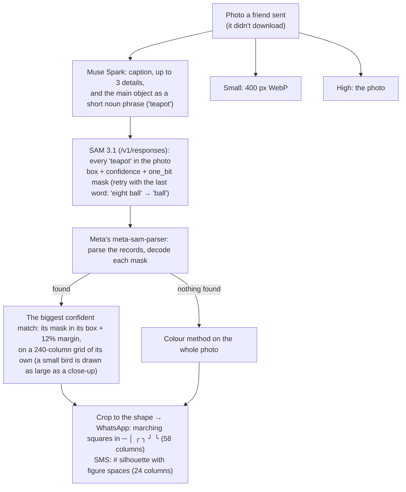

**SAM 3.1 on the Meta Model API** (`evac/sam.py`):
- **Endpoint:** it's served on `/v1/responses`; `/chat/completions` refuses it. The request is one user message with an `input_text` (the noun phrase) and an `input_image`, plus `metadata: {"mask_encoding": "one_bit", "include_confidence": "true"}`.
- **Answer format:** special tokens in the output text, one record per match:

  ```
  <0f>0<|box;x1=64;y1=96;x2=191;y2=159;w=256;h=256;c=0.75|><|mask;x=0;y=0;c=0.75;data=64,128,!…|>
  ```

  The mask covers the box. Its payload is compressed, and Meta's SAM License doesn't allow reverse-engineering it, so responses are parsed and masks decoded with Meta's own `meta-sam-parser`. That needs Python 3.10+, which is why the project now runs in a Python 3.12 `.venv`.
- **Speed:** a SAM call takes 0.7 to 2.5 s, so a photo reply takes about 2 to 4 s including Muse's description. Responses are cached by image and prompt in `cache/sam/`.
- **Fallbacks:** without the parser, SAM's box is still used and the colour method finds the shape inside it. Without a model key or a match, the colour method runs on the whole photo.

**What SAM's mask fixed:** before it, the shape came from colour: background was the colours along the photo's border, and holes were filled.
- **Busy surroundings:** the teapot came out merged with the cluttered counter.
- **Holes:** the mug's handle came out solid.
- **Thin parts:** the bicycle lost its frame.
- **Black on black:** the 8-ball wasn't found at all.
- **Wrong object:** "Eagle & Waterfall" gave the waterfall instead of the bird.
- **A flock:** the flamingos came out as a vague scene. Now one of the birds is drawn large.

**Drawing:** marching squares read the four corners of each character cell (inside or outside the mask) and pick the piece of line that joins the right edge midpoints. The six pieces are `─ │ ╭ ╮ ╯ ╰`, all one cell wide in Menlo. They always meet their neighbours, so the outline is one closed line. The SMS silhouette uses U+2007 figure spaces as blanks, because ordinary spaces are narrower in SF Pro and squash the shape.

**Test pictures.** The simulator's **One object** samples come from two places:
- **Generated:** six pictures made with **Muse Image** (`muse-image-1.0` on `/images/generations`, about 6 s each), on plain and busy backgrounds, in `sim/samples/`: an apple, a mug, a sneaker, a bicycle against bricks, a dog on grass and a teapot on a cluttered counter.
- **Built in:** macOS's account pictures from `/Library/User Pictures` (a penguin, a fortune cookie and others), converted from HEIC with `sips`.

**A teapot on a cluttered counter:** (WhatsApp text 1310 bytes (246 compressed), photo 76141 bytes). Lid knob, spout, and the handle with the hole through it; none of the counter.

```
Photo: A cozy rustic kitchen counter with a green teapot surrounded by lemon slices, a croissant, herbs, and a mug.
- Green ceramic teapot in the center on a wooden table
- Sliced lemons, garlic, croissant crumbs, and thyme scattered around
- Blurred kitchen background with white cabinets and window light

            #
        ########
  ###  ############# #
   ################  ##
   ###################
    ################
       ###########
         #######
(outline of teapot, found by SAM 3.1)
```

```
                           ╭───╮
                           │   ╰╮
                      ╭────╯    ╰───╮
                  ╭───╯             ╰───╮
  ╭──────╮       ╭╯                     ╰╮ ╭─────────╮
  ╰─╮    ╰╮    ╭─╯                       ╰─╯  ╭────╮ ╰╮
    ╰─╮   ╰─╮╭─╯                             ╭╯    ╰╮ ╰╮
      │     ╰╯                               ╰╮     │  │
      ╰╮                                      │     │  │
       │                                      ╰╮   ╭╯ ╭╯
       │                                       │ ╭─╯ ╭╯
       ╰╮                                      ╰─╯ ╭─╯
        ╰─╮                                     ╭──╯
          ╰─╮                                 ╭─╯
            ╰─╮                             ╭─╯
              ╰─╮                          ╭╯
                ╰─╮                      ╭─╯
                  ╰───╮              ╭───╯
                      ╰──────────────╯
(outline of teapot, found by SAM 3.1)
```

**A mug:** (WhatsApp text 1575 bytes (223 compressed), photo 18261 bytes). The handle's hole is kept (the colour method filled it in).

```
            ╭─────────────────╮
   ╭────────╯                 ╰─────────╮
  ╭╯                                    ╰╮
  │                                      │
  │                                      ╰────────╮
  │                                               ╰──╮
  │                                       ╭───────╮  ╰╮
  │                                      ╭╯       ╰─╮ ╰╮
  │                                      │          │  │
  │                                      │          │  │
  │                                     ╭╯          │  │
  ╰╮                                    │          ╭╯ ╭╯
   │                                    │         ╭╯ ╭╯
   │                                    │       ╭─╯ ╭╯
   │                                    │     ╭─╯  ╭╯
   │                                    ╰─────╯  ╭─╯
   ╰╮                                        ╭───╯
    │                                     ╭──╯
    ╰╮                                 ╭──╯
     │                                ╭╯
     ╰╮                              ╭╯
      ╰─╮                         ╭──╯
        ╰──────╮           ╭──────╯
               ╰───────────╯
(outline of mug, found by SAM 3.1)
```

**A bicycle against a brick wall:** (WhatsApp text 2093 bytes (364 compressed), photo 114534 bytes). Both wheels and the frame; thin parts are where 58 columns run out of detail.

```
        ╭──────╮
        ╰──────╳────╮ ╭──────────╮
               ╰──╮ ╰╮╰──────────╳─╮
                  ╰╮╭╯          ╭╯ ╰───────╮
                  ╭╯│           ╰──╮     ╭─╯
                 ╭╯ ╰╮            ╭╯╭────╯
                ╭╯   ╰────────────╯ │
                │  ╭─────────────╮  ╰─╮
              ╭─╯  │             │    ╰─────────────╮
        ╭─────╯    ╰╮           ╭╯               ╭─╮│
      ╭─╯           ╰╮         ╭╯                ╰─╳╯
     ╭╯              ╰╮        │                   ╰╮
    ╭╯                ╰╮      ╭╯                    ╰╮
   ╭╯               ╭╮ ╰╮     │                      ╰╮
   │                ╰╳╮ │    ╭╯                       │
  ╭╯                 │╰╮╰╮  ╭╯                        ╰╮
  │                  │ ╰╮╰╮╭╯                          │
  │                 ╭╯  │ ╰╯                          ╭╯
  │                 │   │                             │
  │                ╭╯   │                             │
  ╰╮              ╭╯    │╭╮                           │
   │             ╭╯     ││╰─╮                        ╭╯
   ╰╮           ╭╯ ╭────╯│  │ ╭╮                     │
    ╰─╮        ╭╯  ╰─────╯  ╰─╯│                    ╭╯
      ╰────────╯               ╰╮                  ╭╯
                                ╰─╮              ╭─╯
                                  ╰─╮          ╭─╯
                                    ╰──────────╯
(outline of bicycle, found by SAM 3.1)
```

**Flamingos:** (WhatsApp text 1397 bytes (268 compressed), photo 96269 bytes). SAM found 27; the biggest confident one is drawn, cropped to it: head, curved neck, body and legs.

```
                                             ╭────╮
                                          ╭──╯    ╰──╮
                                          │          ╰─╮
                                          │    ╭─╮     │
                                          ╰╮   │ ╰╮    │
                   ╭─────────────────╮     ╰╮  ╰─╮╰╮   │
              ╭────╯                 ╰──╮   │    │ ╰───╯
            ╭─╯                         ╰───╯    │
         ╭──╯                                   ╭╯
      ╭──╯                                     ╭╯
   ╭──╯                                      ╭─╯
   │                                       ╭─╯
   ╰─────────╮                           ╭─╯
             ╰──╮                   ╭────╯
                │  ╭╮         ╭─────╯
              ╭─╯╭─╯╰──╮  ╭───╯
           ╭──╳──╯     │  │
         ╭─╯╭─╯        │  │
        ╭╯ ╭╯          ╰╮╭╯
        ╰╮ │            ││
         │ │            ││
         ╰─╯            ╰╯
(outline of 1 of 27 flamingos, found by SAM 3.1)
```

## Weather radar

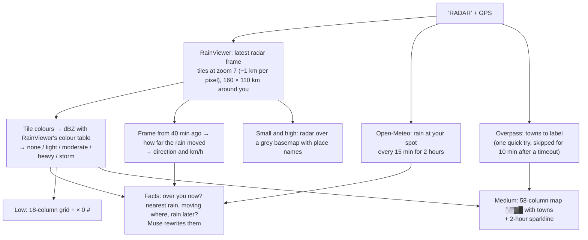

RainViewer's free tiles go up to zoom 7 and have a fixed colour scheme, so `radar.PALETTE` maps colours back to radar strength (dBZ) using RainViewer's published colour table. It has no forecast frames, so the 2-hour timeline comes from Open-Meteo.

Example: "Find heavy rain right now" picked `(-9.6838, -40.7812)` (Bahia, Brazil) on 2026-10-28 02:10 UTC. Radar is live, so this differs every run.

Low data:

```
Hi! 23:00 check: dry over you now :) Nearest light rain 31 km NE, moving toward the SW at about 26 km/h. Good news: no rain for your spot in the next 2 hours!

RADAR (north is up, 160 km across):
 000              
 0××      ++      
 ××              ×
× 00     🔴         
×000×××           
××00000××       00

+ light  × moderate
0 heavy  # storm
🔴 you
```

Medium data (2.0 KB, 0.36 KB compressed; small picture 4.6 KB; full picture 51 KB):

```
┌─ ↑ N  radar 23:00 ───────────────────────────────────────┐
│   ░▒░   ▓▓▓                                              │
│     ▒▒                                                   │
│    ▒▓▓                                                   │
│    ▒▓▓                                                   │
│                                  ░░░                     │
│          ▒▒                                              │
│     ▒▒▒░                                                 │
│     ░░░░                                               ▒▒│
│                                                         ▒│
│      ▒▒▓▓▓▒                🔴                            │
│░░     ▒▓▓▓▒                                              │
│▒▒░   ▒▒▒ ▒▒▒                                             │
│▒▒░░▒▒▒▒▒░░░ ░░░                                          │
│▒░░░▒▒▓▓▓▓▓▓▒▒▒░░░                                        │
│▒▒░░▒▒▓▓▓▓▓▓▒▒▒▒▒▒░▒▒░                                    │
│░  ▒░░▒▓▓▓▓▓▓▒▒▒▒▒▒▒▓▒▒                               ▒   │
│       ▒▒░▒▓▓▓▓▓▒▒▒▒▒▒▒                             ░░▒░░▒│
│ ░▒ ░░░▒░▒▒▓▓▓▓▓▓▓▓▓▓▒▒▒  ▒▒                        ░▒▓▓░▒│
└─ ├───────┤ 25 km ────────────────────────────────────────┘

Your spot, next 2 h (15 min steps): ········
23:00 now  ...  00:45

░ light  ▒ moderate  ▓ heavy  █ storm   🔴 you
```

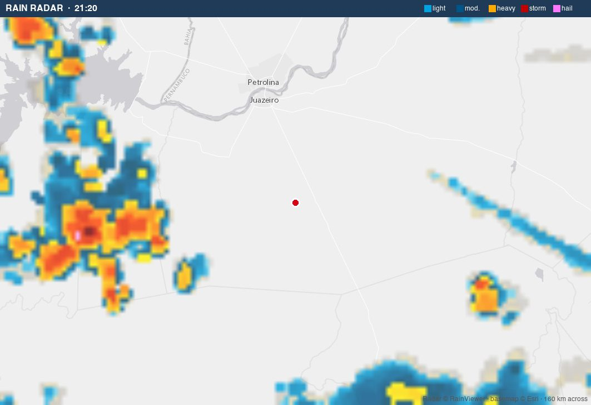

## Walking directions abroad

For someone roaming on a capped plan. Asked directly, Muse Spark gives directions from memory: they read well, but it can't know where you are standing, some turns were wrong (for Rossio to the castle in Lisbon it sent us through the Arco da Bandeira into Praça da Figueira, which it doesn't lead to), and its sketch wasn't to scale. Here the route comes from real street data and Muse only rewords it.

**One step at a time.** A list of eleven turns is useless when you're standing at the first one, and a map of the whole walk is mostly streets you don't need yet. So each message carries the minimum:
- the current step, only as far as the next intersection;
- which way to turn there;
- a landmark to look for;
- a map zoomed to just that stretch.

The next step comes when the phone's position changes. The walk is a **trip**: the streets are downloaded once, and every new GPS fix re-routes on them in about a second.

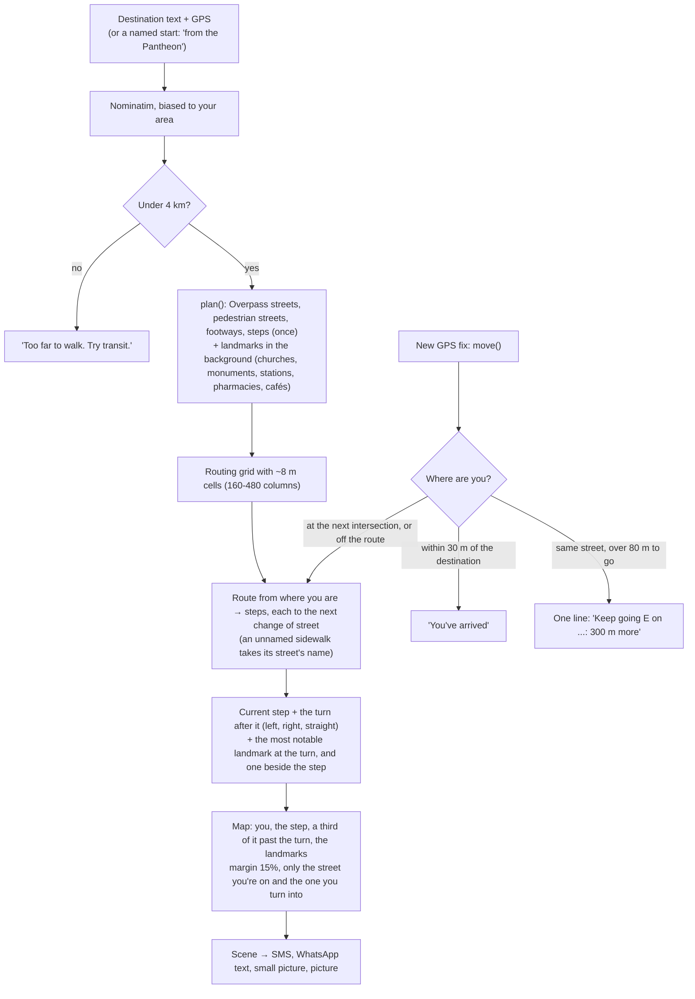

- **Steps end where the street changes.** They come from a grid with ~8 m cells, not the old fixed 160 columns. At 160 columns a 1.5 km walk in Rome had 25 × 49 m cells, and the first step read "head E on unnamed road for 910 m". Sidewalks, which OpenStreetMap often maps as separate unnamed footways, take the name of the street beside them.
- **Landmarks:**
  - **Which ones:** from OpenStreetMap, ranked by how hard they are to miss. Churches, monuments, viewpoints, stations, theatres and fountains come first, then pharmacies, banks and supermarkets, then cafés and restaurants.
  - **At the turn:** the most notable one within a quarter of the step (15 to 40 m) gets "at …". A very notable one right beside the step gets "past …".
  - **Wording:** the type is added unless the name says it: "Bebedouro dos Anjinhos (fountain)", "Rossio (subway entrance)". A landmark named after the street you're on is skipped.
  - **Download:** about 30 s the first time for an area. The reply waits at most 5 s for it, then goes without; the download finishes in the background and is cached.
- **The zoom follows the step.** The map is fitted to you, the step, a third of it past the turn and the landmarks, with a 15% margin. Only the street you're on and the one you turn into are drawn, clipped to near the route.
- **A named start** ("walk from the Pantheon to the Colosseum") is geocoded and used instead of GPS. The `walking_route` tool takes it as `start`, the keyword fallback reads "from X to Y", and the CLI has `--from`.

```bash
python3 main.py --walk "Castelo de São Jorge, Lisbon" --at 38.7139,-9.1406 -v
```

Low data (6 SMS parts):

```
Castelo de São Jorge: 0.7 km, about 9 min.
Now: head E on Calçada do Carmo for 120 m, to the next corner.
Then turn left onto the path ahead at Bebedouro dos Anjinhos (fountain).

MAP (north is up):
              
=             
 🔴         === 
=> v  =>>>>>>>Λ 
 =>>>Λ   =¤   
              
              

= open road
< > Λ v route
🔴 you
¤ Bebedouro dos Anjinhos
```

Medium data (1732 bytes, 395 compressed, picture map 46649 bytes). The map is 140 m across: the street you're on, the square you reach, a ★ at the fountain where you turn, and the castle as an edge marker:

```
┌─ ↑ N ────────────────────────────────────────────────────┐
│                                                          │
││ Largo do Duque do Cadaval                               │
│││                                                        │
││││ 🔴 YOU                                       ──╲╲     │
│ ││ ↓                                               ╲│    │
│  ││↓→                                     │        ↑→    │
│  │││↓→          Praça Dom Pedro IV ┃┃      ╲╲     ↑→│   ⌂│
│   ││ ↓→                          ── ┃       ╲╲───↑→      │
│    ││ ↓→         ││   ↑→→→→→→→→→→→→→→→→→→→→→→→→→→→       │
│    │││ ↓→         │  ↑→─────         ┃┃                  │
│     │││ ↓→    ────┼┼↑→           Bebedouro dos Anjinhos  │
│     ─┼╲╲─↓→→→→→→→→→→→                       ★            │
│       ───           │                                    │
│ Calçada do Carmo    ││                                   │
│                      │ Rua 1º de Dezembro                │
│                                                          │
└─ ├──────┤ 20 m ──────────────────────────────────────────┘

🔴 you
→ route
⌂ destination
★ landmark
━ main road   ─ street
```

Small picture and full picture of the same step:

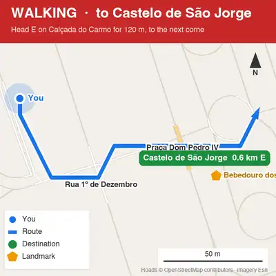 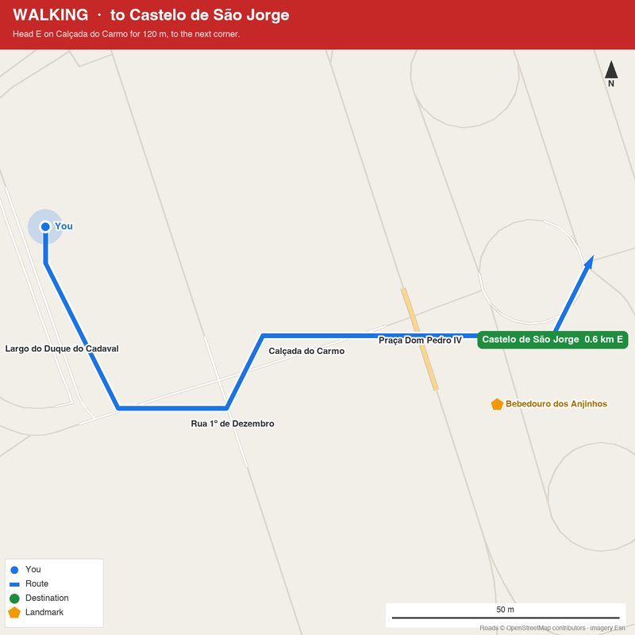

**As you walk.** The same trip after three simulated GPS fixes (`directions.move`; the simulator's **Walk 60 m** and **Take a wrong turn** buttons). Updates are templates, with no model call:

```
=== GPS fix: you walked 60 m -> next step (new map, 1.3 s)
Now: head E on Calçada do Carmo for 70 m, to the next corner.
Then keep straight onto the path ahead.
Castelo de São Jorge: 0.6 km, about 8 min.

MAP (north is up):
              
         =    
 = >>>>>>>>== 
= 🔴 Λ=   =     
  =           
              
              

= open road
< > Λ v route
🔴 you

┌─ ↑ N ────────────────────────────────────────────────────┐
│                                                          │
│                                          ││              │
│                                ┃┃         ╲          ╱╱  │
│                                 ┃┃         ╲╲╲     ╱╱╱   │
│                            ───   ┃           ╲────╱╱     │
│       ││     ↑→→→→→→→→→→→→→→→→→→→→→→→→→→→→→→→→→→→→→→     │
│        │    ↑→ ──────             ┃┃                    ⌂│
│        ││──↑→──                    ┃                     │
│   ──────┼ ↑→                       ┃┃                    │
│───  🔴→→→→→                                              │
│     YOU  ││                                              │
│           │                                              │
│            │ Rua 1º de Dezembro                          │
│            ││                                            │
│                                                          │
└─ ├──────────┤ 20 m ──────────────────────────────────────┘

🔴 you
→ route
⌂ destination
━ main road   ─ street

=== GPS fix: you walked 60 m -> next step (new map, 1.0 s)
Now: head E on unnamed road for 50 m, past Bebedouro dos Anjinhos (fountain), to Praça Dom Pedro IV.
Then keep straight onto Praça Dom Pedro IV.
Castelo de São Jorge: 0.6 km, about 8 min.

MAP (north is up):
              
      =====   
 =  = =>>>>   
  🔴 >>>>Λ      
  = ¤         
              
              

= open road
< > Λ v route
🔴 you
¤ Bebedouro dos Anjinhos

┌─ ↑ N ────────────────────────────────────────────────────┐
│                                                          │
│                           ─               ┃              │
│                            ──╲╲           ┃┃             │
│                               ╲╲           ┃             │
│                                ││───────   ┃┃            │
│                 │               ↑→→→→→→→→→→→→→→→→→→      │
│                 ││             ↑→            ┃           │
│      ┃           ╲╲           ↑→│            ┃┃          │
│      ┃┃           ╲╲╲        ↑→╱              ┃          │
│       ┃             ╲╲─────╱↑→  Castelo de São J 0.5 km ⌂│
│      ←→🔴→→→→→→→→→→→→→→→→→→→→                            │
│        ┃┃                                                │
│         ┃                                                │
│          ┃                                               │
│          ┃┃                                              │
│ Praça Dom Pedro IV ★ Bebedouro dos Anjinhos              │
│                                                          │
└─ ├────────────┤ 20 m ────────────────────────────────────┘

🔴 you
→ route
⌂ destination
★ landmark
━ main road   ─ street

=== GPS fix: you took a wrong turn -> off route, re-routed (new map, 0.9 s)
Off route, new way:
Now: head NE on Praça Dom Pedro IV for 30 m, to Largo de São Domingos.
Then turn right onto Largo de São Domingos.
Castelo de São Jorge: 0.5 km, about 7 min.

MAP (north is up):
              
        >==   
    ===>Λ=    
    = >Λ==    
   ==>Λ  =    
 === 🔴         
              

= open road
< > Λ v route
🔴 you

┌─ ↑ N ────────────────────────────────────────────────────┐
│                                                          │
│                                            ││            │
│                                            │             │
│                                        ↑  ││             │
│                                       ↑→  │              │
│                                      ↑→  ││              │
│                                     ↑→───┼               │
│                                 ───↑→──                  │
│                           ─────── ↑→                     │
│                    ───────       ↑→                      │
│                   ──            ↑→                       │
│                                ↑→                        │
│                               ↑→                         │
│                              ↑→ Castelo de São J 0.5 km ⌂│
│                          ━━━↑→━━━━━━━━━━━━━              │
│                     ╱╱━━━━ ↑→                            │
│                   ╱╱╱     ↑→                             │
│               ╱╱╱╱       ↑→                              │
│            ╱╱╱╱ YOU     ↑→                               │
│          ╱╱╱    🔴→→→→→→→                                │
│       ╱╱╱                                                │
│      ╱╱ Praça Dom Pedro IV                               │
│                                                          │
└─ ├─────────────────┤ 20 m ───────────────────────────────┘

🔴 you
→ route
⌂ destination
━ main road   ─ street
```

## Why the text maps line up

All the maps are drawn from map data, one meaning per character cell, not converted from a photo pixel by pixel:

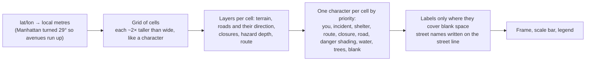

- **iPhone Messages uses SF Pro, a proportional font.** Ordinary ASCII art comes out crooked, so the SMS maps use only characters measured (in a browser canvas, `17px system-ui`) to be exactly one digit wide: `= # + < > 0 $ ¤ £ ¥ ×` and U+2007 FIGURE SPACE for blanks. Narrow ones are padded with thin and hair spaces (`|`, `v`); slightly wide ones (`Λ` +6%, `S` +1.2%) appear at most once or twice per row. Each row's width error is added up and logged (`worst row drift`); the examples are 0.03 to 0.04 cells. Figure spaces and `×` are outside the GSM-7 alphabet, so these messages are UCS-2: 67 characters per SMS part.
- **WhatsApp shows text in triple backticks in a monospace font, but can't colour it.** So the medium maps use line drawing (`━ ┃ ╋ ╱ ╲`) and shading (`░▒▓█`), all one cell wide in Menlo, Monaco and Courier. Braille dots, common in ASCII art, are avoided: on a Mac they fall back to another font and come out 14% wider. A WhatsApp bubble is at most 65% of the chat pane, which in the simulated window fits 58 columns without wrapping.
- **"You" is the 🔴 red dot in both**, the only way to get colour. It is wider than a character, so it takes two cells: exactly two in SF Pro (with padding), a third of a cell short in Menlo (about 2.5 px on that one row).
- **Street names** go at the end of rows on the SMS map (never inside the grid) and are dropped if the row would wrap in the bubble. On the WhatsApp map, Manhattan street names are written on the street line itself so they can't be read as the street above or below, and avenue names go in a header.

Previews of the SMS maps in SF Pro on a Mac (not yet checked on a real iPhone):


## Try it: the simulator

```bash
python3 sim/server.py
```

Open http://127.0.0.1:8765. In the Claude desktop app, `.claude/launch.json` starts it in the browser pane. Every tab shows the result four ways with real sizes, and the **Person's connection** picker highlights the version that would be sent.

- **Emergency:** the left phone is **Emergency Response (555) 010-0911**. Type an alert or pick a sample (NYC fire, NYC gas leak, LA wildfire, Pasadena flood) and choose who gets it: **Bob the Builder**, **Wendy** or **Farmer Pickles**, each with their own GPS. Move someone and press **Text MAP** for a fresh reply. The pipeline log shows what Muse parsed and the alignment check.
- **Weather radar:** pick a city, type coordinates, or press **Find heavy rain right now**.
- **Directions abroad:** pick a starting station (Lisbon, Paris, Rome, Tokyo) and a destination; type a place in **From** to start somewhere other than your GPS. Then simulate the phone's GPS: **Walk 60 m along the route** or **Take a wrong turn**. Each update joins the thread, and the status line says whether the next step (with its map) was sent or just a line of text.
- **Photo:** the **One object** samples (a penguin, a fortune cookie, a gingerbread man... macOS's account pictures, converted with `sips`) are the case the outline is built for; the **Scenes** are macOS desktop pictures.
- **Ask anything:** the router. Pick where you are (Rome, Lisbon, NYC), type anything or pick an example, optionally attach a photo; the tools Muse called are listed under the box.
- **Clear** empties every thread, result and the log.

## Run it from the command line

Python 3.10 or newer: Meta's SAM 3.1 parser (`meta-sam-parser`) needs it. A virtual environment keeps it separate:

```bash
python3.12 -m venv .venv
```

```bash
.venv/bin/pip install -r requirements.txt
```

```bash
source .venv/bin/activate
```

Without `meta-sam-parser`, SAM still finds objects (their boxes), but outlines inside the boxes come from colour.

Put your Meta Model API key in `.env` (git-ignored):

```
LLAMA_API_KEY=...
```

Optional settings in `.env`: `LLM_BASE_URL` (default `https://api.meta.ai/v1`), `LLM_MODEL` (default `muse-spark-1.3`), `SAM_MODEL` (default `sam-3.1`), `LLM_REASONING_EFFORT` (default `minimal`). Without a key: keyword routing, regex alert parsing, no photo descriptions, template text.

```bash
python3 main.py --ask "Is it going to rain on my walk to the Colosseum?" --at 41.9010,12.5016   # the router
python3 main.py --ask "what is this?" --photo some.jpg --at 40.75,-73.98                        # router + photo
python3 main.py samples/palisades_fire.txt --at 34.0445,-118.5300 -v                           # alert → SMS reply
python3 main.py samples/nyc_fire.txt --at 40.75491,-73.97441 --laptop 58                       # + the WhatsApp map
python3 main.py --photo some.jpg                                                               # photo → text versions
python3 main.py --radar 40.7128,-74.0060                                                       # weather radar as text
python3 main.py --walk "Castelo de São Jorge, Lisbon" --at 38.7139,-9.1406 -v                   # walking directions
```

`-v` prints the log: the parsed alert, the distance check, closures found, the map's alignment check, and every tool call with its result.

## Code

| File | Role |
| --- | --- |
| `evac/router.py` | One entry point: Muse picks tools (parallel, up to 3 rounds), writes the reply; the kept results become the versions |
| `evac/tools.py` | The 10 tools, their JSON descriptions, the per-request `Context`, `call()` that never raises |
| `evac/scene.py` | The `Scene`: what to draw, shared by every renderer |
| `evac/focus.py` | Which roads a map draws (walked, turn landmarks, main roads, closures, anchors) and the view fitted to them |
| `evac/render.py` | Scene → `sms`, `mono`, `small`, `picture` |
| `evac/textmap.py` | SMS maps aligned for SF Pro (Manhattan street grid, raster elsewhere) |
| `evac/laptopmap.py` | Monospace maps for WhatsApp: line-drawn roads, shading, labels, route arrows |
| `evac/imagemap.py` | Picture maps (JPEG, or WebP drawn small) in the style of agency alert maps; `shrink()` for photos and radar |
| `evac/pipeline.py` | The fixed emergency reply: parse, locate, route, word, build the Scene |
| `evac/directions.py` | A walk as a `Trip`: streets and landmarks downloaded once, re-routed at every GPS fix (`move`); one step at a time, to the next intersection, with its turn, a landmark and a map of just that stretch; optional named start |
| `evac/radar.py` | RainViewer tiles → rain levels, motion, Open-Meteo forecast, its four versions |
| `evac/photo.py` | Muse description; the one object's outline (found by SAM 3.1, shaped by its mask or by colour inside its box; cropped; marching squares) or the borders of the main regions |
| `evac/sam.py` | SAM 3.1 client on `/v1/responses`: records parsed and masks decoded with Meta's `meta-sam-parser`; boxes only without it; cached in `cache/sam/` |
| `evac/notice.py` | Alert text → fields (Muse, regex fallback); unit conversion in code |
| `evac/grid.py` | Grid: terrain, roads, closures, hazard, Dijkstra, turn-by-turn directions (`legs` also gives where each step starts) |
| `evac/osm.py` | Overpass queries (roads, walkable paths, towns, landmarks) cached in `cache/`; street-name matching ("5 Av" = "Fifth Avenue"); intersections |
| `evac/geo.py` | Geocoding, distance, local projection |
| `evac/imagery.py` | XYZ tile stitching (Esri aerial, Esri grey basemap, RainViewer radar) |
| `evac/segment.py` | Aerial image → terrain masks: SAM 3.1 for water, a colour heuristic for trees and buildings |
| `evac/llm.py` | Meta Model API client (`chat`, `chat_json`, `chat_tools`); loads `.env`; `reasoning_effort` minimal |
| `main.py` | Command line: `--ask`, alerts, `--photo`, `--radar`, `--walk` (+ `--from`), `--laptop N` |
| `sim/server.py` | Simulator server: `/api/message` (router), `/api/alert`, `/api/photo`, `/api/radar`, `/api/directions`, `/api/directions/move` (simulated GPS), `/api/find_rain`, sample photos |
| `sim/index.html` | The tabs, the four-way result cards, the connection picker |
| `CLAUDE.md` | Notes for Claude Code: commands, how the pieces connect, the text-map width rules |

## Data sources

Roads, paths and towns © OpenStreetMap contributors (via Overpass); geocoding by Nominatim; aerial imagery and grey basemap © Esri; radar © RainViewer; forecast by Open-Meteo. Picture maps carry these credits.

## Known limits

- Not yet checked on a real iPhone or in real WhatsApp (fonts, emoji widths, Bold Text, text size).
- The free Overpass servers are the slow, flaky part: a new area takes 30 s to 2 minutes or times out. A new query now goes to all three mirrors at once (first answer wins, 40 s limit), an area already inside an earlier download is cut from it, and an alert waits at most 15 s for its map's streets: after that it is routed on the aerial image alone, and the download finishes in the background for the next reply. Before, the mirrors were tried one by one at 60 s each and an alert in the simulator took over 2 minutes. The intersection lookup still waits (a wrong location is worse than a slow one); when the geocoder misses "Lexington Av and E 51 St" and falls back to the middle of Lexington Avenue, it now also searches around the reader instead of placing the leak 1.9 km away.
- Radar town names often time out and are then skipped. "Find heavy rain" works on a coarse world view, so the spot it picks can sit in a gap between storms.
- Radar and photos still produce their own versions; the next step makes them Scenes (a grid of values) so the router can, for example, draw the rain on the walking-route map.
- Muse's wording isn't checked against the tool results; the prompt asks it to keep every number and name. It sometimes adds an estimate (the Trevi Fountain reply guessed a 20-minute walk).
- Photo outlines draw one object: of several matches (a flock), only the biggest confident one. At 58 columns very thin parts (spokes, a bicycle's cables) are lost. If Muse doesn't name a main object (a landscape), the drawing falls back to the borders of the photo's main colour regions.
- SAM is weak on top-down aerial tiles: it outlined the ocean cleanly but found almost no trees or buildings (45 of Manhattan's buildings covering 16% of a 1 km view; nothing for "forest" or "town" over the Palisades). So the maps take only **water** from SAM and keep the colour heuristic for trees and buildings.
- Steps run to the next intersection where the street *name* changes, so in an old town some are only 20 m long, and a square counts as a street. Landmarks come from OpenStreetMap names: sometimes the square you're already in, or a local name a visitor won't know (the place type is added, e.g. "(subway entrance)"). The first landmark download for an area takes about 30 s, so that first reply goes without landmarks.
- Walking updates need the phone to send its position. The simulator moves "you" along the route or onto a nearby street off it; a real deployment needs the person to share their location, or reply with it. The wrong-turn button sometimes picks a street behind you.
- Trees and buildings in the aerial terrain come from a colour heuristic (only water comes from SAM). Walking maps don't use terrain at all, so they make no SAM call per step.
- SMS replies are long: 6 to 12 parts.
