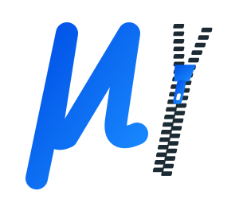
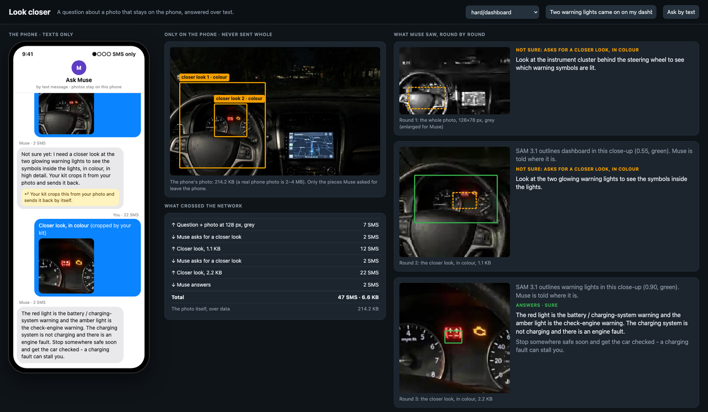
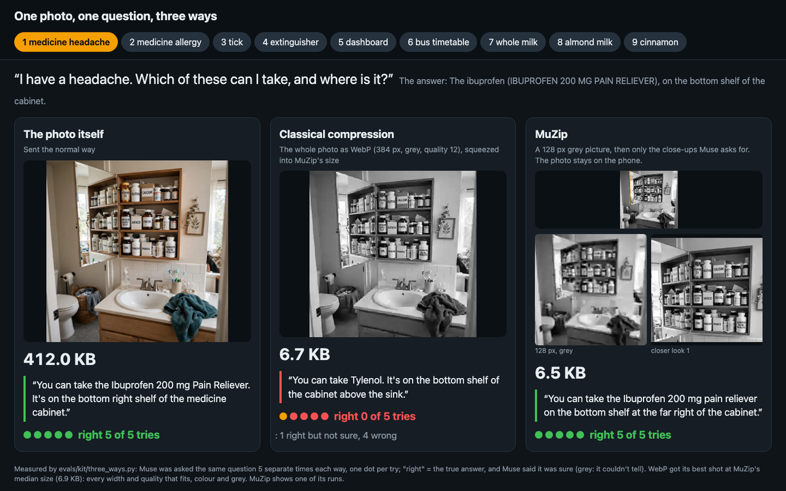
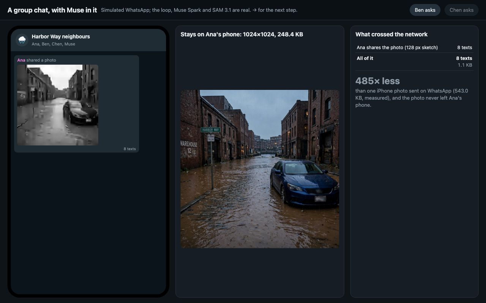
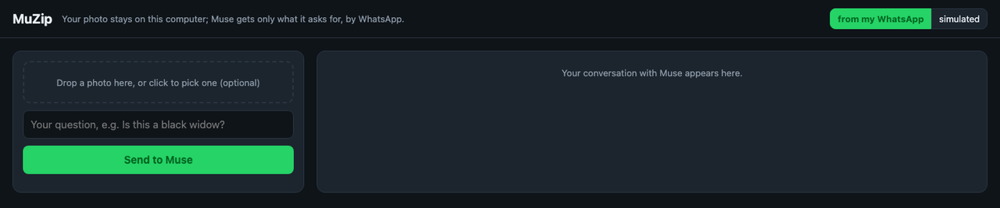

<h1><picture><source media="(prefers-color-scheme: dark)" srcset="docs/logo-dark.svg"></picture></h1>

**Agentic compression for photos.** Instead of shrinking the whole photo and hoping the detail survives, MuZip sends
a tiny sketch and lets the AI on the other end ask for exactly the parts it needs to answer your question. The photo
stays on your phone; what crosses the link is under a hundredth of it, as ordinary text messages.

Built on the Meta Model API: **Muse Spark** decides what to look at, **SAM 3.1** outlines it, **Muse Image** made
the test photos.

[](https://www.youtube.com/watch?v=WLSNYIcfzSI)

**[Watch the demo video (2:49)](https://www.youtube.com/watch?v=WLSNYIcfzSI)**

## How it works

1. **The phone sends the question and a 128 px grey sketch of the photo** (a WebP, about 10 texts).
2. **Muse Spark looks and decides.** If it is sure, it answers. If not, it asks for a close-up (or a few at once, for
   two or three separate small things): a box on any view so far (the whole photo, or inside an earlier close-up), in
   colour or grey, at normal (128 px) or high (256 px) detail, and says what it wants to see there.
3. **The phone crops those parts of its own full-size photo,** each in its box's shape, and sends them back by itself,
   as text, in one message.
4. **SAM 3.1 outlines the thing on each close-up,** and Muse is told exactly where it sits in the whole photo. When
   Muse asks for something small inside a close-up, SAM places the box: Muse decides what to look at, SAM finds
   exactly where.
5. **Again, until Muse is sure,** within a budget (160 texts or 8 close-ups). It may not answer "can't tell" or
   "fairly sure" while it can still look, and a box that repeats a view it already has is refused with the reason.
   To tell two or three small symbols apart (dashboard warning lights), it closes in on each one by itself, at the
   photo's own pixels, asking for all of them in one round trip.

Classical compression keeps what your eye would notice, for anyone, for any question. MuZip keeps what this question
needs. On a cabinet of thirty look-alike bottles ("which of these is for a headache?") one high-detail close-up of the
shelves is enough; on an office corridor ("can I use this fire extinguisher?") it zooms in three times, each close-up
inside the last, until it reads "EMPTY / RECHARGE".

**A photo with no question** is a share: Muse picks the one part that matters, asks for it once in colour at high
detail, and sends the sketch with that part sharp, plus a sentence ("A fallen tree is lying on top of a grey SUV":
6.5 KB in all, where WhatsApp sent the photo as 659 KB). "@MuZip show me Alex's photo" is a share too. **A second question
about the same photo** starts from the close-ups the phone already sent, at no cost, so in a group chat each person's
question costs only what is new.

## How Meta's models are used

| Model | What it does here |
| --- | --- |
| **Muse Spark** | Looks at the sketch and every close-up so far and decides what it still needs to see: where, in colour or not, at what detail, and why. Answers once it is sure. Judges answers in the evals. |
| **SAM 3.1** | Outlines the thing Muse named on each close-up, so Muse knows exactly where it is in the whole photo. |
| **Muse Image** | Made the generated test photos (the prompts are in `sim/samples/hard/prompts.json`). |

What we learned about them:

- **SAM needs pixels.** It found nothing under about 20 px in the 128 px sketch, however it was enlarged or restored
  first. So Muse aims the first close-up from context, and SAM works on the close-ups
  ([evals/closer/RESULTS.md](evals/closer/RESULTS.md)).
- **Muse has to be told what it already has.** Without being told how much closer each view is, it asked eight times
  for the same view of a timetable. Without the rule against answering unsure, it gave up a shelf too early.

## Try it

| To try | You need | Setup |
| --- | --- | --- |
| **The simulator** (a simulated phone, the side-by-side, a group chat) | Python 3.12, a Meta Model API key | 2 minutes |
| **MuZip over WhatsApp, from your phone** | the above, a Twilio account (free), `cloudflared`, WhatsApp on a phone | 15 minutes |
| **MuZip on a Mac** (the photo stays on the Mac, sent from your own WhatsApp) | all of the above, WhatsApp Desktop | 5 more minutes |
| The offline tests | Python 3.12 only | 1 minute |

### 1. Install (once)

```bash
git clone https://github.com/JacobOuyang/muzip.git && cd muzip
```

```bash
python3.12 -m venv .venv && .venv/bin/pip install -r requirements.txt
```

Make a file called `.env` in the repo's folder (it is git-ignored) with your Meta Model API key. This one key runs
Muse Spark and SAM 3.1:

```
LLAMA_API_KEY=your-meta-model-api-key
```

Check the install (no key or network needed):

```bash
.venv/bin/python -m unittest discover tests
```

### 2. The simulator: one command

```bash
.venv/bin/python sim/server.py
```

Then open one of these in a browser:

- **http://127.0.0.1:8765/closer**: pick a photo, type a question, press **Ask by text**. On the left is a simulated
  phone that only sends texts; in the middle the photo that never leaves it, with every close-up Muse asked for; on the
  right, what Muse saw each round. Underneath is every text that crossed the network.

  

- **http://127.0.0.1:8765/compare**: the same question three ways (the photo itself, WebP squeezed to MuZip's size,
  MuZip), from saved runs. Pick a photo along the top.

  

- **http://127.0.0.1:8765/demo**: four scenes in one page; press → to step through. **/group** is a simulated
  WhatsApp group: one neighbour shares a photo, the others each ask about it.

  

### 3. Over WhatsApp, from your phone

WhatsApp messages reach MuZip through Twilio's free WhatsApp sandbox. Twilio forwards each message to a small server on
your computer (the bridge), so the bridge needs a public address: `cloudflared` gives it one for free.

1. **Make a Twilio account** at [twilio.com](https://www.twilio.com/try-twilio) (the free trial is enough). In the
   Console:
   - On the home page, copy the **Account SID** and **Auth Token**.
   - Open **Messaging → Try it out → Send a WhatsApp message**. Note the sandbox's number and its join phrase
     (`join <two words>`).
2. **Add them to `.env`**, with your own WhatsApp number:
   ```
   TWILIO_ACCOUNT_SID=AC...
   TWILIO_AUTH_TOKEN=...
   MY_WHATSAPP=+15551234567
   ```
3. **Join the sandbox:** from WhatsApp on your phone, send the join phrase to the sandbox's number. Do this once for
   every phone that will use it, and again if a phone has been silent for a few days (Twilio drops it).
4. **Install `cloudflared`** (on a Mac: `brew install cloudflared`) and start a tunnel to the bridge's port. Leave it
   running:
   ```bash
   cloudflared tunnel --url http://127.0.0.1:8770
   ```
   It prints an address like `https://some-words.trycloudflare.com`. Add it to `.env`:
   ```
   PUBLIC_URL=https://some-words.trycloudflare.com
   ```
5. **Start the bridge** in another terminal (after `PUBLIC_URL` is set: it checks every message's Twilio signature
   against that address). Leave it running:
   ```bash
   .venv/bin/python sim/whatsapp_server.py
   ```
6. **Point the sandbox at it:** back in Twilio, open the sandbox's **Sandbox settings**, set **When a message comes
   in** to your `PUBLIC_URL` followed by `/whatsapp` (for example `https://some-words.trycloudflare.com/whatsapp`),
   method **POST**, and save.
7. **Try it:** send the sandbox's number a photo with a question ("Which warning lights are these?"). The bridge plays
   the phone's part: it keeps your photo, sends Muse the sketch, crops each close-up Muse asks for, and tells you each
   step. A photo with no question gets the one part that matters, sharp, and a sentence about it. `help` says what it
   can do.

**Every time you restart `cloudflared`** the address changes: repeat steps 4 to 6 (new `PUBLIC_URL`, restart the
bridge, update the sandbox's URL).

### 4. MuZip on a Mac

This keeps the photo on your Mac and sends the sketch and every close-up from your own WhatsApp account, as text,
to the sandbox's number. It needs everything in step 3 running, plus WhatsApp Desktop, signed in.

```bash
bash sim/make_muzip_app.sh
```

Open `out/MuZip.app` once and allow it in **System Settings → Privacy & Security → Accessibility** (it only presses
Return in WhatsApp; re-allow it after every rebuild). Then:

```bash
.venv/bin/python sim/muzip.py
```

Open http://127.0.0.1:8780, drop a photo, type a question, and press **Send to Muse**. **simulated** sends straight to
the bridge instead of through WhatsApp Desktop (the replies still reach your WhatsApp).



### If something doesn't work

- **No reply on WhatsApp:** look at the bridge's terminal. Nothing there means Twilio isn't reaching it: check the
  sandbox's URL ends in `/whatsapp` and matches the current tunnel. `bad signature` means `PUBLIC_URL` doesn't match
  the tunnel's address: fix it and restart the bridge.
- **Twilio says the number isn't in the sandbox:** send the join phrase again.
- **Muse doesn't answer** (in the simulator or on WhatsApp): check `LLAMA_API_KEY`. Optional settings:
  `LLM_BASE_URL` (default `https://api.meta.ai/v1`), `LLM_MODEL` (default `muse-spark-1.3`).
- **MuZip types the message but doesn't send it:** re-allow `out/MuZip.app` under Accessibility.

### For developers

The loop's own eval, after any change to it (12 questions x 3 runs in parallel, about 2 minutes, compared with a saved
baseline):

```bash
.venv/bin/python evals/loop/run.py
```

The three-way comparison behind `/compare` (slow; it asks every question five times each way):

```bash
.venv/bin/python evals/kit/three_ways.py
```

## Code

| Area | Files |
| --- | --- |
| The loop | `evac/closer.py` (what Muse sees, decides and asks for), `evac/sam.py` (SAM 3.1) |
| Codes | `evac/codes.py` (photos and close-ups as text: `P`, `Z`, `ZOOM … C H`, `RESEND`), `evac/smsimage.py` (the sketch) |
| Router and store | `evac/router.py` (codes first, then the loop, else a plain answer), `evac/store.py` (every photo, close-up and message, in SQLite) |
| WhatsApp | `evac/whatsapp.py`, `sim/whatsapp_server.py`, `sim/muzip.py`, `sim/make_muzip_app.sh`, `sim/wa_phone.py` |
| Simulator | `sim/server.py`, `sim/closer.html`, `sim/compare.html`, `sim/closer_demo.py`, `sim/phones.py` |
| Evals | `evals/kit/three_ways.py` (three ways), `evals/loop/` (the loop's eval), `evals/kit/webp_vs_normal.py` (sizes), `evals/closer/` (SAM on small pictures) |

[HOW_IT_WORKS.md](HOW_IT_WORKS.md) has the details with real runs.

**The demo:** `.venv/bin/python sim/server.py`, then http://127.0.0.1:8765/demo: four scenes (three
ways, look closer, a simulated WhatsApp group with Muse in it, a drone), live with the models. See
[demo/README.md](demo/README.md) and the voice-over in [demo/SCRIPT.md](demo/SCRIPT.md). The video itself is rendered
from pages in `sim/video/` with `demo/video/render.py` (see HOW_IT_WORKS.md).

**Branches:** `main` is MuZip, with the demo and the video's pages. `full-prototype` keeps everything this started as: text maps for emergency alerts, walking
directions, weather radar, photo drawings, an offline kit page and a neighbourhood hub.

## Limits

- **Dense small text in big photos** is the weak spot: on a timetable or a price tag across an aisle, MuZip runs out of texts before it can read it.
- **WhatsApp through Twilio's sandbox** is the live channel; plain SMS works the same way but wasn't set up.
- **Muse aims the first close-up from context alone,** because SAM can't find small things in the sketch.
- **The test set is small:** nine questions in the comparison, twelve in the loop's eval, half on generated photos.
