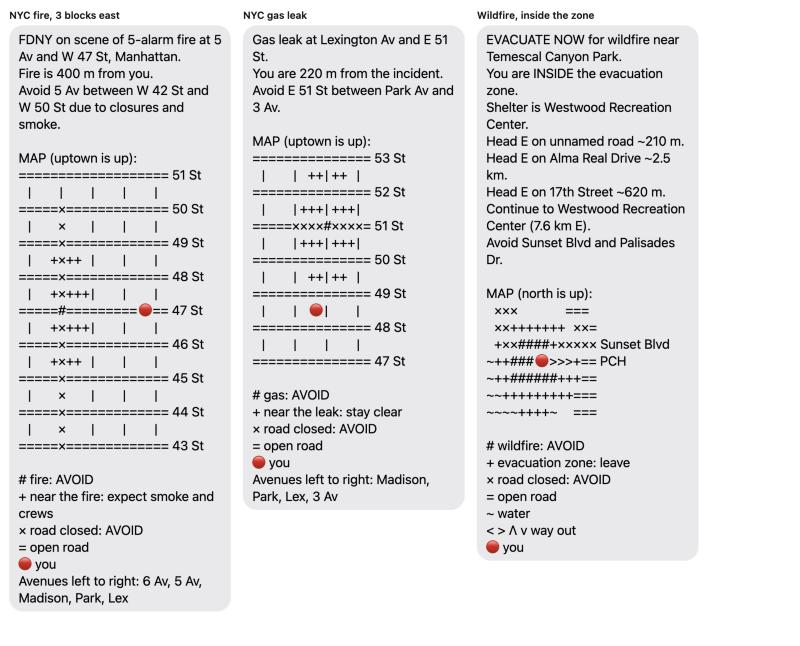

# MapsImagesText

Turns an emergency alert text message into a reply that tells one person whether they are affected, what to avoid, and which way to go, with a small map drawn in text that lines up inside an iPhone Messages bubble. Everything rides on SMS, so it works when data is congested or down.

Built on the Meta Model API (Muse Spark; SAM 3.1 planned).

## What it does

Given an alert and the person's location, it:

1. Reads the alert with **Muse Spark**: hazard, order type, where it is, radius, shelters, and closed roads as street segments (`5 Av` from `W 42 St` to `W 50 St`).
2. Finds the incident. The place is looked up as written (not biased toward the reader, which once put a Manhattan fire in Los Angeles for a reader there). Intersections like "5 Av and W 47 St" are then pinned down in OpenStreetMap road data, because the geocoder alone placed that one about 600 m off and could not find "Lexington Av and E 51 St" at all.
3. Checks distance: far away gets one line ("no action needed"); inside or near gets the full reply.
4. Pulls aerial imagery and the road network, marks closed segments and the danger zone, and routes out of danger on a grid (lowest-risk path to a shelter or a safe road).
5. Draws a **text map** and writes the message: plain instructions first (Muse Spark rewrites them), then the map, then a legend.

## Try it: two-phone simulator

```bash
python3 sim/server.py
```

Open http://127.0.0.1:8765. The left phone is **Emergency Response (555) 010-0911**: type an alert or pick a sample (NYC fire, NYC gas leak, LA wildfire, Pasadena flood) and choose who receives it. The right phone belongs to **Bob the Builder**, **Wendy** or **Farmer Pickles**; each has their own thread and GPS (one-click places in Midtown, Brooklyn, Pacific Palisades, Santa Monica and South Pasadena, or typed coordinates). Each person gets the alert followed by a reply worked out for their location. Move someone and text **MAP** from their phone to get a fresh reply. The emergency phone shows each reply's size in SMS parts and time; the pipeline log shows what Muse parsed and the map's alignment check.

Example: sending the NYC fire alert to all three gives Bob (47 St near Park Av) a 12-part map, Wendy (5 Av & 43 St) a 9-part map, and Farmer Pickles (Pacific Palisades) one line: "You are 3962.0 km outside the fire zone. No action needed."

Bubbles use SF Pro at 17 px with the iMessage bubble width, so maps line up as they would on an iPhone. In the Claude desktop app, `.claude/launch.json` starts it in the browser pane.

## How the text map works

iPhone Messages draws texts in SF Pro, a proportional font, so ordinary ASCII art comes out crooked. Measured in SF Pro at 17 pt, these characters are all exactly one digit wide, and the map uses only them:

| Symbol | Meaning | Width |
| --- | --- | --- |
| `=` | open road | exact |
| `×` | road closed: avoid | exact |
| `#` | the hazard: avoid | exact |
| `+` | zone around it | exact |
| `~` | water | exact |
| `<` `>` | way out, west / east | exact |
| `Λ` | way out, north | +6%, one per row at most |
| `v` | way out, south | padded with hair spaces, +0.3% |
| 🔴 | you | emoji, 17 px, padded to exactly two cells (−0.4 px) |
| `\|` | avenue line | padded with thin space + space, exact |
| `S` | shelter | +1.2% |
| (blank) | U+2007 figure space | exact |

Street names go at the end of rows, where words can't knock anything out of line, and names that would make a row wrap in the bubble are dropped. The code adds up each row's width error and logs it (`worst row drift`); current examples are 0.04 cells (0.4 px, from the red dot). A pixel or two is fine; a whole cell is not.

Two layouts:

- **Street grid** (`render_grid`): for incidents named at a Manhattan intersection. Rows are streets, columns are avenues, placed from the real street data in the grid's own frame (uptown is up). Closures along an avenue or along a street are drawn between their cross streets.
- **Raster** (`render_raster`): everything else. The routing grid is shrunk to about 16 cells wide and the route is drawn as arrows.

Because figure spaces and `×` are outside the GSM-7 SMS alphabet, messages use UCS-2: 67 characters per SMS part. Current replies are 9 to 12 parts, which an iPhone joins into one bubble.

Previews rendered in SF Pro on a Mac (not yet checked on a real iPhone):



## Examples

GitHub shows the code blocks below in a fixed-width font, where the padded `|` lines look slightly off; in Messages they line up (see the previews above).

### NYC fire, you are 3 blocks east

Input: [`samples/nyc_fire.txt`](samples/nyc_fire.txt), location `40.75491,-73.97441`

```
NotifyNYC (DRILL - fictional sample): FDNY is on scene of a 5-alarm fire at 5 Av and W 47 St, Manhattan. Expect road closures and smoke in the area. Avoid 5 Av between W 42 St and W 50 St.
```

```bash
python3 main.py samples/nyc_fire.txt --at 40.75491,-73.97441
```

Output:

```
FDNY on scene of 5-alarm fire at 5 Av and W 47 St, Manhattan.
Fire is 400 m from you.
Avoid 5 Av between W 42 St and W 50 St due to closures and smoke.

MAP (uptown is up):
=================== 51 St
  |     |     |     |     |  
=====×============= 50 St
  |    ×    |     |     |  
=====×============= 49 St
  |   +×++  |     |     |  
=====×============= 48 St
  |   +×+++ |     |     |  
=====#========= 🔴 == 47 St
  |   +×+++ |     |     |  
=====×============= 46 St
  |   +×++  |     |     |  
=====×============= 45 St
  |    ×    |     |     |  
=====×============= 44 St
  |    ×    |     |     |  
=====×============= 43 St

# fire: AVOID
+ near the fire: expect smoke and crews
× road closed: AVOID
= open road
🔴 you
Avenues left to right: 6 Av, 5 Av, Madison, Park, Lex
```

### NYC gas leak, a street closure

Input: [`samples/nyc_gas_leak.txt`](samples/nyc_gas_leak.txt), location `40.7560,-73.9740`

```
NotifyNYC (DRILL - fictional sample): Con Edison and FDNY responding to a gas leak at Lexington Av and E 51 St, Manhattan. Avoid E 51 St between Park Av and 3 Av. Expect delays.
```

Output:

```
Gas leak at Lexington Av and E 51 St.
You are 220 m from the incident.
Avoid E 51 St between Park Av and 3 Av.

MAP (uptown is up):
=============== 53 St
  |     |  ++ | ++  |  
=============== 52 St
  |     | +++ | +++ |  
=====××××#××××= 51 St
  |     | +++ | +++ |  
=============== 50 St
  |     |  ++ | ++  |  
=============== 49 St
  |     |   🔴  |     |  
=============== 48 St
  |     |     |     |  
=============== 47 St

# gas: AVOID
+ near the leak: stay clear
× road closed: AVOID
= open road
🔴 you
Avenues left to right: Madison, Park, Lex, 3 Av
```

### Wildfire, you are inside the zone

Input: [`samples/palisades_fire.txt`](samples/palisades_fire.txt), location `34.0445,-118.5300`

```
LAFD ALERT: Wildfire. MANDATORY EVACUATION ORDER for all residents within 2 miles of Temescal Canyon Park. Leave now. Evacuation center open at Westwood Recreation Center. Avoid Sunset Blvd and Palisades Dr.
```

Output:

```
EVACUATE NOW for wildfire near Temescal Canyon Park.
You are INSIDE the evacuation zone.
Shelter is Westwood Recreation Center.
Head E on unnamed road ~210 m.
Head E on Alma Real Drive ~2.5 km.
Head E on 17th Street ~620 m.
Continue to Westwood Recreation Center (7.6 km E).
Avoid Sunset Blvd and Palisades Dr.

MAP (north is up):
 ×××      === 
 ××+++++++ ××=
 +××####+××××× Sunset Blvd
~++### 🔴 >>>+== PCH
~++######+++==
~~+++++++++===
~~~~++++~  ===

# wildfire: AVOID
+ evacuation zone: leave
× road closed: AVOID
= open road
~ water
< > Λ v way out
🔴 you
```

## Run it

```bash
pip install requests pillow numpy
```

Put your Meta Model API key in `.env` (git-ignored):

```
LLAMA_API_KEY=...
```

Optional settings in `.env`: `LLM_BASE_URL` (default `https://api.meta.ai/v1`), `LLM_MODEL` (default `muse-spark-1.3`), `LLM_REASONING_EFFORT` (default `minimal`). Without a key, alerts are parsed with regexes and the message uses a template.

```bash
python3 main.py samples/palisades_fire.txt --at 34.0445,-118.5300 -v
```

`-v` prints the parsed alert, the distance check, closures found and the map's alignment check.

## Code

| File | Role |
| --- | --- |
| `CLAUDE.md` | Notes for Claude Code: commands, how the pieces connect, the text-map width rules |
| `main.py` | Command line: alert file + `--at lat,lon` |
| `sim/server.py` | Simulator server: serves the page, runs the pipeline per recipient (`POST /api/alert`) |
| `sim/index.html` | The two simulated iPhones, profiles, GPS controls and pipeline log |
| `evac/pipeline.py` | Wires the steps together and composes the message |
| `evac/notice.py` | Alert text to structured fields (Muse Spark, regex fallback); unit conversion happens here, not in the model |
| `evac/llm.py` | Meta Model API client; loads `.env`; `reasoning_effort` minimal (1 to 2 s per call instead of 5 to 10) |
| `evac/geo.py` | Geocoding, distance, local projection |
| `evac/osm.py` | Roads from OpenStreetMap (cached in `cache/`), street-name matching ("5 Av" = "Fifth Avenue"), intersection finding |
| `evac/imagery.py` | Aerial tiles for the map area |
| `evac/segment.py` | Aerial image to terrain masks (SAM 3 path, or a colour heuristic) |
| `evac/grid.py` | Routing grid: roads, closures, hazard, lowest-risk route, turn-by-turn directions |
| `evac/textmap.py` | The SF Pro-aligned text maps |

## Known limits

- Not yet checked on a real iPhone (letter spacing, Bold Text, text size).
- Replies are long: 9 to 12 SMS parts.
- The wildfire map is coarse (about 600 m per cell), and some directions say "unnamed road".
- New areas wait on the public OpenStreetMap server, which can take 1 to 2 minutes or time out.
- Terrain comes from a colour heuristic; SAM 3.1 on the Meta Model API is not wired in yet.
- Sample NYC alerts are fictional drills.
