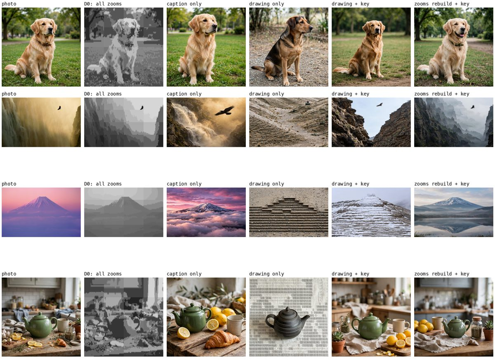

# Photo drawing evals: results

36 photos: every sample in the simulator. That's 6 single objects made with Muse Image, 10 photos of single objects
(macOS account pictures) and 20 scenes (macOS desktop pictures). Method: [README.md](README.md). Every photo with
its drawings and recreations: `out/eval/report.html` (`.venv/bin/python evals/photo_eval.py --report`). Raw numbers:
[summary.json](summary.json).

## 1. Subject stands out, background lighter

The high drawing now shades the background with only blank, `·` and `░`, and the subject from its own tones with
`░ ▒ ▓` inside a heavy outline. The "faithful" column below is the same segmentation shaded on one scale, as before.

| | before (faithful) | now (as sent) |
|---|---|---|
| Subject darker than the background | 16 / 36 photos | **34 / 36** |
| Subject ink ÷ background ink (median) | 0.75 | **2.92** |
| Background ink (mean) | 0.31 | **0.09** |
| Muse names the subject from the drawing alone | 6% | **19%** |
| Tone correlation with the photo | **0.70** | 0.52 |
| Edge F1 | **0.79** | 0.76 |

The emphasis costs tone fidelity on purpose: the background is no longer as dark as in the photo.

## 2. How good is the high drawing?

Measured against the photo at the drawing's own 58-column grid:

| Metric | low (outline) | high, faithful | high, as sent |
|---|---|---|---|
| Muse names the subject (blind: no caption, no key) | **24%** | 6% | 19% |
| Muse's scene vs the caption (0-10) | **2.0** | 1.4 | 1.8 |
| Tone: correlation with the photo | – | **0.70** | 0.52 |
| Tone: SSIM per cell | – | 0.41 | 0.40 |
| Edges: F1 (precision / recall) | – | 0.79 (0.69 / 0.95) | 0.76 (0.78 / 0.80) |
| Subject shape: IoU with SAM's mask | – | 0.81 | 0.82 |
| Bytes (gzipped) | 1,436 (202) | 2,895 (286) | 2,891 (253) |
| Time to draw (average) | 13 s | | 10 s |

- **The drawing alone rarely tells a viewer what the photo is.** Muse named the subject from a drawing alone in
  about a fifth of the photos. Identity comes from the words sent with it (the caption and the key).
- **Outline vs tonal depends on the photo.** The outline is better for single objects: Muse named 67% of the
  generated objects from it, against 50% from the tonal drawing. The tonal drawing is better for scenes: 15% vs 11%,
  scene score 1.6 vs 1.2.
- **The tonal drawing keeps the scene's structure:**
  - **Edges:** 95% of the photo's strongest edges in the faithful version.
  - **The subject's shape:** IoU 0.82.

## 3. How much of the photo can be recomposed from text alone?

### Without a model (D0: decode every drawing to grey, paste zooms in)

0% = the photo's average grey everywhere (SSIM 0.52); 100% = the photo averaged into a 232-column grid (SSIM 0.94).

| What was sent | Bytes | SSIM | Recovered |
|---|---|---|---|
| Base drawing (with its 40-byte tone legend) | 2.9 KB | 0.60 | 19% |
| + `ZOOM` on the first 3 numbered parts | 11.6 KB | 0.62 | 20% |
| + every 2×2 zoom | 14.2 KB | 0.68 | 36% |
| + every 2×2 and 4×4 zoom | 58.7 KB | 0.77 | **54%** |
| Greedy order (server picks the most useful zoom next) | 54.5 KB | 0.77 | 54% |

**What limits it.** The ceilings below are the photo itself averaged into the grid, then snapped to the 5 glyphs'
ink, to its own best 5 or 10 greys, or left at any grey:

| Grid | 5 glyphs, fixed ink | 5 adaptive greys | 10 adaptive greys | any grey |
|---|---|---|---|---|
| 58 columns | 0.55 | 0.69 | 0.71 | 0.73 |
| 116 columns | 0.58 | 0.76 | 0.79 | 0.83 |
| 232 columns | 0.61 | 0.82 | 0.88 | 0.94 |

- **The base drawing reaches about half of what a 58-column, 5-grey picture could** (0.60 of 0.69). The loss is
  the segmentation: each region gets one flat tone, where a per-cell tone would keep gradients and texture.
- **With every zoom, the rebuild reaches 82% of the 232-column, 5-grey ceiling** (0.77 of 0.82). At that point the
  tone count limits it: 10 greys would raise the ceiling to 0.88.
- **The tone legend matters.** Each drawing sets its own scale, so without the legend `░` means a different grey in
  every zoom, and adding zooms made the rebuild worse (0.70 → 0.46 on the eagle) until it was added.
- **Zooms on numbered parts barely help the rebuild** (+1 point). They're for reading a part. The tiles are what
  rebuild the picture. In the greedy order, 90% of the gain arrives by about 35 KB (median).
- **For scale:** a greyscale JPEG of the same 2.9 KB reaches SSIM 0.90, and at 59 KB, 0.98. Text is a poor
  picture format, about 20 times less efficient. It's worth it only because it travels where pictures can't (SMS,
  a WhatsApp text on a trickle of data).

### With a model (D1: Muse Image recreates the photo)

Layout = correlation of 16-column grey thumbnails with the photo (unrelated photos: 0.02). Subject = SAM's box for
the subject on the photo vs on the recreation. Judge = Muse comparing the two (0-10).

| Input to Muse Image | Layout r | Subject IoU | Judge: subject / layout / overall |
|---|---|---|---|
| Caption only (no drawing) | 0.37 | 0.51 | 8.9 / 6.4 / 7.0 |
| Text drawing only | 0.20 | 0.00 | 0.9 / 2.1 / 1.0 |
| Text drawing + key | 0.34 | 0.44 | 6.8 / 4.3 / 4.8 |
| Drawing decoded to grey + key | 0.50 | 0.41 | 7.1 / 4.9 / 5.2 |
| Drawing decoded to grey + caption | 0.52 | 0.54 | 8.4 / 5.9 / 6.6 |
| All zooms decoded + key | 0.72 | 0.59 | 8.5 / 6.9 / 7.1 |
| **All zooms decoded + caption** | **0.75** | **0.67** | **9.1 / 7.5 / 7.7** |

- **Never give an image model the raw text drawing.** It copies the glyph texture literally: Mt Fuji's shaded steps
  became a stepped stone pyramid, and a dotted background became a dotted cloth. The subject was lost every time.
  Decoding to grey first lifts layout from 0.20 to 0.50.
- **What the receiver has (one drawing + the caption) recomposes the layout at r 0.52**, against 0.37 from the
  caption alone. With every zoom (about 55 KB of text) it reaches 0.75, the subject lands in the right place
  (IoU 0.67), and the judge gives 7.7 of 10.
- **What comes back:**
  - **From the drawing:** where things are and which areas are light or dark.
  - **From the words:** what the subject is and its colours.
  - **Not at all:** fine texture.

## 4. Caveats

- **Muse judges Muse.** Muse writes the description, reads the drawing blind and judges the match, so the
  recognition numbers are a proxy for a person, not a measurement of one.
- **One sample each:** every recreation is a single Muse Image sample.
- **SAM as the reference:** SAM's mask is the "true" subject for the shape score.
- **The dataset:** 36 photos, mostly clean stock-style images.
- **What SSIM measures:** SSIM at 232 px rewards structure and tone, not meaning.

## 5. Next steps this suggests

1. **Per-cell tones inside regions** (for zooms, or a faithful mode): the base drawing could go from 0.60 towards the
   0.69 a 58-column, 5-grey grid allows, at no extra bytes.
2. **More tones when zoomed in.** A 10-step ASCII ramp (` .:-=+*#%@`, all one cell in Menlo) lifts the 232-column
   ceiling from 0.82 to 0.88.
3. **Server-chosen zooms.** The greedy order gets 90% of the gain in about 35 KB. When the connection allows, the
   server could send the next most useful zoom unprompted.
4. **A receiver with an image model** should decode to grey first, then recreate with the caption.
5. **Readability needs a human test.** Only about one drawing in five is named blind by Muse. The next experiment
   is people reading the same drawings at real phone size.
